# Estimación

La estimación de historias de usuario es un proceso colaborativo que realiza el equipo de desarrollo para determinar el esfuerzo requerido para completar una tarea o una _historia de usuario_. El objetivo no es predecir con exactitud el tiempo que llevará, sino asignar un valor relativo que represente la complejidad, la incertidumbre y el volumen de trabajo.

## ¿Por qué estimar _Historias de Usuario_?

Estimar las historias de usuario es fundamental en la metodología ágil por varias razones clave:

  * Ayuda en la planificación. Permite al _Product Owner_ priorizar el _backlog_ y prever cuánto trabajo se puede completar en futuras iteraciones (sprints).

  * Fomenta el entendimiento común. El proceso de estimación obliga al equipo a discutir los requisitos en detalle, lo que ayuda a descubrir supuestos no declarados y a alinear la comprensión de todos sobre lo que se debe construir.

  * Facilita la toma de decisiones. Con estimaciones, el equipo puede tomar decisiones más informadas sobre el alcance del trabajo y gestionar las expectativas de los interesados.

  * Mejora la velocidad del equipo. Al medir el trabajo completado en cada sprint (la "velocidad"), el equipo puede hacer proyecciones más fiables a largo plazo.

## Los _Story Points_

En lugar de estimar en horas o días, los equipos ágiles suelen utilizar _Story Points_ (Puntos de Historia). Un _Story Point_ es una unidad de medida abstracta que representa una combinación de:

  * Complejidad: ¿Cuán difícil es de desarrollar?

  * Incertidumbre: ¿Cuántas incógnitas existen? ¿Se ha hecho algo similar antes?

  * Esfuerzo: ¿Cuánto trabajo implica?

La escala más común para los _Story Points_ se basa en la secuencia de Fibonacci (1, 2, 3, 5, 8, 13, 21...). Esta escala no lineal ayuda a reflejar la creciente incertidumbre que acompaña a las tareas más grandes. Una historia de 8 puntos no es simplemente "el doble" que una de 4 (si se usara una escala lineal), sino que es significativamente más compleja e incierta.

Para empezar a usar _Story Points_, el equipo primero debe establecer una historia de referencia. Se elige una historia de usuario pequeña y bien entendida por todos y se le asigna un valor bajo (por ejemplo, 2 puntos). A partir de ahí, todas las demás historias se estiman por comparación: "¿Esta nueva historia es más o menos compleja que nuestra historia de referencia de 2 puntos?".

## Técnicas estimación

Existen varias técnicas para facilitar el proceso de estimación en equipo. Las más utilizadas:

### Planning Poker

Es la técnica más extendida y se desarrolla de la siguiente manera:

  1. **Presentación de la historia**. El _Product Owner_ explica la historia de usuario y responde a las preguntas del equipo de desarrollo.

  2. **Discusión interna**. El equipo discute los detalles técnicos y los pasos necesarios para completar la historia.

  3. **Votación secreta**. Cada miembro del equipo elige en secreto una carta de una baraja de [Planning Poker](https://en.wikipedia.org/wiki/Planning_poker#/media/File:CrispPlanningPokerDeck.jpg) (con números de la secuencia de Fibonacci) que representa su estimación.

  4. **Revelación y consenso**. Todos los miembros revelan su carta al mismo tiempo.
  
  <ul>
  4.1 Si las estimaciones son similares, se toma el valor acordado y se pasa a la siguiente historia.

  4.2 Si hay grandes diferencias, los miembros con las estimaciones más altas y más bajas explican su razonamiento. De esta manera se ven posibles malentendidos o aspectos que otros no habían considerado.
  </ul>

  5. Repetición: El proceso se repite hasta que el equipo llega a un consenso en la estimación.

```mermaid
flowchart LR
    A[Presentación de la historia] --> |El Product Owner explica y responde preguntas| B[Discusión interna]
    B --> |El equipo analiza detalles técnicos| C[Votación secreta]    
    C --> |Cada miembro elige una carta Fibonacci| D[Revelación y consenso]

    D --> E{¿Las estimaciones son similares?}
    E --> |Sí| F[ Se toma el valor acordado<br/>y se pasa a la siguiente historia]
    E --> |No| G[Miembros con valores extremos explican<br/>sus razones y aclaraciones]
    G --> H[Repetición del proceso]
    H --> |Hasta llegar a consenso| F

    style A fill:#f3f0ff,stroke:#6c63ff,stroke-width:2px
    style B fill:#e3f2fd,stroke:#42a5f5,stroke-width:2px
    style C fill:#fff3e0,stroke:#fb8c00,stroke-width:2px

    style D fill:#ede7f6,stroke:#7e57c2,stroke-width:2px
    style E fill:#fff9c4,stroke:#fbc02d,stroke-width:2px
    style F fill:#c8e6c9,stroke:#43a047,stroke-width:2px
    style G fill:#ffe0b2,stroke:#fb8c00,stroke-width:2px
    style H fill:#d1c4e9,stroke:#7e57c2,stroke-width:2px
```

### T-Shirt Sizing (Tallas de Camiseta)

Esta técnica es muy buena para estimar un gran número de historias de forma rápida, como al inicio de un proyecto.

  * El equipo asigna tallas de camiseta (XS, S, M, L, XL) a las historias de usuario en lugar de números.

  * Es una forma rápida de agrupar las historias por tamaño relativo sin entrar en debates detallados sobre puntos específicos.

  * Posteriormente, estas tallas se pueden convertir a _Story Points_ (por ejemplo, S = 2, M = 5, L = 8).

### Dot Voting (Votación por Puntos)

Es un método simple y visual para priorizar o estimar de manera colectiva.

  * Se escriben todas las historias de usuario en post-its y se colocan en una pared.

  * Cada miembro del equipo recibe un número limitado de puntos adhesivos (dots).

  * Los miembros colocan sus puntos en las historias que consideran más grandes o complejas.

  * Las historias con más puntos son percibidas como las de mayor esfuerzo.

## Cómo realizar una sesión de estimación exitosa

  **Preparación**. El _Product Owner_ debe tener las historias de usuario bien definidas y listas para ser discutidas. Es fundamental que estén escritas desde la perspectiva del usuario y que incluyan criterios de aceptación claros.

  **Reunir al equipo correcto**. En la sesión deben participar todos los miembros del equipo de desarrollo (programadores, testers, diseñadores, etc.), el Scrum Master (como facilitador) y el _Product Owner_ (para aclarar dudas).

  **Establecer la historia de referencia**. Si es la primera vez que el equipo estima, deben acordar una historia de referencia que servirá para todas las futuras estimaciones.

  **Discutir cada historia**. Analizar una historia a la vez. El equipo debe hacer todas las preguntas necesarias para entender el alcance completo.

  **Estimar y llegar a un consenso**. Utilizar una de las técnicas mencionadas (como Planning Poker) para que el equipo asigne un valor de _Story Points_ a la historia.

  **Mantenerlo ágil**. No hay que dedicar demasiado tiempo a una sola historia. Si una historia es demasiado grande o ambigua para ser estimada, probablemente necesite ser dividida en historias más pequeñas y manejables. 