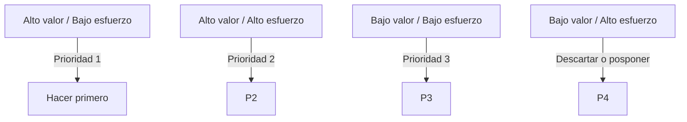

<SlidesViewer>

# **Metodologías Ágiles: Traduciendo necesidades en valor**

### Proyecto Intermodular II | Requisitos. Historias de usuario

## 1. Fundamentos de los requisitos

- ¿Qué es un requisito?

   > Un requisito es algo que el sistema debe hacer o una característica que debe tener.

- Tipos: funcionales y no funcionales

## 2. Historias de usuario

- Definición:

  > Explicación informal y general de una funcionalidad de software

- Estructura

  > Como `<usuario>`, quiero `<acción>` para `<beneficio>`

- Ejemplo práctico:

:::tabs
==Equipo DAW

| ID     | Historia de Usuario                                        |
| ------ | --- |
| DAW-03 | Como **miembro del equipo**, quiero **asignar tareas a otros usuarios** para **distribuir el trabajo**.                    |

==Equipo DAM

| ID     | Historia de Usuario                                                                              |
| ------ | ------------------------------------------------------------------------------------------------ |
| DAM-02 | Como **usuario móvil**, quiero **ver mis tareas en una lista ordenada por prioridad** para **no olvidar las más urgentes**.             |

==Equipo ASIR

| ID      | Historia de Usuario              |
| ------- |  ------------------------------- |
| ASIR-03 | Como **devops**, quiero **configurar backups automáticos de la base de datos** para **garantizar la recuperación ante fallos**.                          |

:::

## 3. Criterios de aceptación / DoD / DoR

- ¿Qué son?
- Criterios claros y medibles
- Relación con historias de usuario

- Definition of Ready: conjunto de condiciones que una historia debe cumplir antes de ser aceptada en el sprint

  ```text
    “Como usuario quiero recibir notificaciones cuando se me asigne una tarea.”

    Antes del sprint, está definido el endpoint /api/notifications, el mockup del pop-up y el comportamiento offline.
  ```

| Historia de Usuario | Criterios de Aceptación |
|---------------------|------------------------|
| HU-01: Como nuevo usuario, quiero registrarme con mi email y contraseña para poder acceder a mi cuenta     | - Campos obligatorios <br> - Validación <br> - Acceso tras registro |

- Definition of Done: calidad

  ```text
  El código compila sin errores y supera las pruebas instrumentadas.
  ```

## 4. Estimación de historias de usuario

- Técnicas de estimación: Planning Poker, T-shirt sizes, Dot Voting
- Importancia de la colaboración en la estimación

## 5. INVEST: Buenas historias de usuario

- Independiente, Negociable, Valiosa, Estimable, Pequeña, Testeable
- Ejemplo de aplicación del acrónimo INVEST

| Letra | Significado                     | Explicación Breve                                      |
|:------|:--------------------------------|:--------------------------------------------------------|
| **I** | Independent (Independiente)     | Puede desarrollarse sin depender de otras.             |
| **N** | Negotiable (Negociable)         | Se puede discutir y ajustar con el PO.                 |
| **V** | Valuable (Valiosa)              | Aporta valor al usuario o negocio.                     |
| **E** | Estimable (Estimable)           | El equipo puede estimar su esfuerzo.                   |
| **S** | Small (Pequeña)                 | Puede completarse en un solo sprint.                   |
| **T** | Testable (Verificable)          | Tiene criterios claros que permiten probarla.          |

## 6. Priorización de historias de usuario

- Criterios: valor y Esfuerzo
- Técnicas: Matriz de valor vs. esfuerzo



## 7. Ejemplos

:::tabs
==Equipo DAW

## Historia de Usuario: DAW-03 - Asignación de Tareas

### Identificador

**DAW-03**

### Historia de usuario

Como **miembro del equipo**,  
quiero **asignar tareas a otros usuarios**,  
para **distribuir el trabajo** de manera eficiente dentro del proyecto.

### Objetivo

Permitir que los usuarios con permisos adecuados (por ejemplo, colaboradores o administradores) puedan asignar tareas a otros miembros del equipo desde la aplicación web de **TaskFlow**, garantizando trazabilidad y comunicación efectiva.

### Criterios de Aceptación

1. El sistema debe permitir al usuario seleccionar una tarea y asignarla a cualquier otro miembro del proyecto con permisos válidos.  
2. Cuando la asignación se complete, el sistema debe mostrar una confirmación visual (por ejemplo, una notificación o un mensaje “Tarea asignada correctamente”).  
3. El usuario asignado debe recibir una notificación en su panel de tareas y/o por correo electrónico.  
4. Si un usuario intenta asignar una tarea sin tener los permisos necesarios, el sistema debe impedirlo y mostrar un mensaje de error claro.  
5. Si el usuario al que se intenta asignar la tarea ya no forma parte del proyecto, el sistema debe mostrar una advertencia y no permitir la acción.  
6. Todos los cambios deben reflejarse inmediatamente en la base de datos y ser visibles para los demás miembros del equipo.  

### Estimación

**Story Points:** 5  

(Se considera una historia de complejidad media, ya que requiere interacción con permisos, actualización de modelos y notificaciones.)

### Prioridad

**Alta (P1)**  
La funcionalidad es esencial para la colaboración y la gestión eficiente de tareas dentro del ecosistema TaskFlow.

### Dependencias

- **DAW-01**: Sistema de autenticación y gestión de roles.  

- **DAW-02**: Creación y visualización de tareas.  

- **DAW-06**: Sistema de notificaciones internas.  

### Definition of Done (DoD)

- [x] El código pasa todos los tests unitarios y de integración.  

- [x] Los permisos se validan correctamente antes de realizar la asignación.  

- [x] El usuario asignado recibe la notificación.  
- [x] La información se refleja correctamente en la interfaz web y en la base de datos.  
- [x] La historia ha sido revisada por QA y aprobada por el Product Owner.  

### Notas Técnicas

- Agregar el campo `assigned_user_id` (tipo `Many2one` hacia `res.users`) en el modelo de tareas.  

- Modificar el controlador y el endpoint REST correspondiente para permitir actualizaciones de asignación.  

- Integrar el sistema de notificaciones con el flujo de asignación.  
- Actualizar la vista de detalle de tareas para reflejar el usuario asignado.  

==Equipo DAM

## Historia de Usuario: DAM-02 - Lista de tareas ordenada por prioridad

### Identificador

**DAM-02**

### Historia de Usuario

Como **usuario móvil**,  
quiero **ver mis tareas en una lista ordenada por prioridad**,  
para **no olvidar las más urgentes**.

### Objetivo

Permitir al usuario visualizar todas sus tareas en la aplicación móvil **TaskFlow** de manera clara y priorizada, de forma que pueda concentrarse primero en las tareas más importantes.

### Criterios de Aceptación

1. La aplicación debe mostrar las tareas del usuario en una lista ordenada de **mayor a menor prioridad**.  
2. Cada tarea debe mostrar: **título, fecha límite, estado y prioridad visual (por color o icono)**.  
3. El usuario debe poder **filtrar** las tareas por estado (Pendiente, En progreso, Completada).  
4. La lista debe actualizarse automáticamente cuando cambie la prioridad de una tarea.  
5. Si el usuario no tiene tareas asignadas, debe mostrarse un mensaje informativo como:  
   *“No tienes tareas pendientes. ¡Buen trabajo!”*  
6. La lista debe cargarse en menos de **2 segundos** en condiciones normales de red.  
7. La vista debe mantener una **jerarquía visual clara**, adaptada a pantallas pequeñas.  

### Estimación

**Story Points:** 3  
*(Funcionalidad de complejidad baja-media, centrada en visualización y ordenamiento de datos desde la API.)*

### Prioridad

**Alta (P1)**  
Es una de las funcionalidades principales del MVP móvil, necesaria para que los usuarios puedan usar TaskFlow de manera efectiva.

### Dependencias

- **DAW-04:** API REST que provee las tareas y su prioridad.  

- **DAM-01:** Sistema de autenticación de usuarios móviles.  

- **DAM-04:** Sistema de sincronización con la API.  

### Definition of Done (DoD)

- [x] Cumple con los criterios de rendimiento (<2s de carga).  

- [x] Probado en dispositivos Android e iOS con diferentes tamaños de pantalla.  

- [x] Validado por el Product Owner y el equipo de QA.  

### Notas Técnicas

- Consumir el endpoint `/api/tasks` con el parámetro `?order_by=priority desc`.  

- Usar componentes de **RecyclerView / FlatList** para rendimiento óptimo.  

- Implementar sistema de **cache local** para cargas rápidas.  
- Seguir el diseño proporcionado en **Figma - TaskFlow Mobile UI Kit v1.2**.

==Equipo ASIR

## Historia de Usuario: ASIR-03 - Configuración de Backups Automáticos

### Identificador

**ASIR-03**

### Historia de Usuario

Como **DevOps**,  
quiero **configurar backups automáticos de la base de datos**,  
para **garantizar la recuperación ante fallos y evitar pérdida de información crítica**.

### Objetivo

Diseñar y desplegar un sistema de **copias de seguridad automáticas** para la base de datos del ecosistema **TaskFlow**, asegurando que los datos puedan restaurarse rápidamente en caso de incidentes o corrupción del sistema.

### Criterios de Aceptación

1. El sistema debe realizar **backups automáticos diarios** de la base de datos.  
2. Los backups deben almacenarse en una ubicación **segura y externa al servidor principal** (por ejemplo, AWS S3, Azure Blob o NAS remoto).  
3. Cada backup debe incluir un **timestamp** en su nombre para facilitar la trazabilidad (ej: `taskflow_backup_20251015_2300.sql`).  
4. Debe existir un mecanismo para **restaurar la base de datos** a partir de cualquier backup disponible.  
5. El sistema debe conservar un histórico de al menos **7 días de backups** antes de eliminar los más antiguos.  
6. Se debe generar un **registro (log)** de cada backup con fecha, duración y estado (éxito/error).  
7. Si un backup falla, el sistema debe **enviar una alerta** (por correo o notificación a Grafana/Slack).  
8. El proceso de backup **no debe afectar el rendimiento** del sistema en producción.  

### Estimación

**Story Points:** 5  
*(Historia de complejidad media, requiere automatización, scripting y configuración de seguridad).*

### Prioridad

**Alta (P1)**  
Es esencial para garantizar la disponibilidad y continuidad del servicio del ecosistema **TaskFlow**.

### Dependencias

- **ASIR-01:** Configuración del entorno de base de datos.  

- **ASIR-02:** Monitorización de recursos del servidor.  

- **DAW-04 / DAM-04:** Uso de la base de datos compartida.  

### Definition of Done (DoD)

- [x] Los backups automáticos se ejecutan correctamente según la programación establecida.  

- [x] Los archivos se almacenan en una ubicación segura y accesible solo para DevOps autorizados.  

- [x] El procedimiento de restauración ha sido probado y documentado.  
- [x] Los logs y alertas funcionan correctamente ante fallos.  
- [x] Verificado por QA y validado por el Product Owner.  

### Notas Técnicas

- Usar **cron jobs** o **systemd timers** para la ejecución automática.  

- Generar backups mediante herramientas nativas (`pg_dump`, `mysqldump`, según la BD utilizada).  

- Subir los backups a almacenamiento remoto con autenticación segura (por ejemplo, **rclone**, **AWS CLI**, **scp**).  
- Guardar logs en `/var/log/taskflow_backups.log` y centralizar en Grafana Loki si aplica.  
- Política de retención configurable en variable de entorno (`BACKUP_RETENTION_DAYS=7`).  
- Incluir pruebas de restauración periódicas para validar integridad.

:::

## 8.1 Actividad práctica: Del requisito a historia de usuario

:::tabs
==Problema

El sistema debe permitir enviar mensajes de texto a otros usuarios en tiempo real.

==Solución DAW

<table style="width:100%; border-collapse: collapse;">
  <thead style="text-align: left;">
    <tr>
      <th style="padding: 8px; border: 1px solid #ddd;">Historia de Usuario</th>
      <th style="padding: 8px; border: 1px solid #ddd;">Definition of Ready (DoR)</th>
      <th style="padding: 8px; border: 1px solid #ddd;">Criterios de Aceptación</th>
      <th style="padding: 8px; border: 1px solid #ddd;">Definition of Done (DoD)</th>
    </tr>
  </thead>
  <tbody>
    <tr>
      <td style="padding: 8px; border: 1px solid #ddd;"><strong>HU-DAW-01</strong>: Como <strong>usuario web</strong>, quiero <strong>enviar mensajes de texto a mis contactos</strong> para <strong>comunicarme al instante</strong>.</td>
      <td style="padding: 8px; border: 1px solid #ddd;"><ul><li>Requisito validado con PO.</li><li>Mockups de la interfaz de chat web disponibles.</li><li>Contrato de la API (`POST /api/messages`) definido y compartido con DAM.</li></ul></td>
      <td style="padding: 8px; border: 1px solid #ddd;"><ul><li>El endpoint debe registrar el mensaje en la BD asociándolo al emisor y receptor.</li><li>La respuesta del endpoint debe ser `201 Created` en caso de éxito.</li><li>El sistema debe validar que el receptor existe.</li></ul></td>
      <td style="padding: 8px; border: 1px solid #ddd; vertical-align: top;" rowspan="2">
        <strong>DoD para la funcionalidad de "Chat en tiempo real":</strong>
        <ul>
          <li>Endpoints documentados en Swagger/OpenAPI.</li>
          <li>Pruebas de integración superadas.</li>
          <li>Código revisado por pares (Peer Reviewed).</li>
          <li>Funcionalidad validada en staging por QA.</li>
          <li>Servicio de notificaciones integrado correctamente.</li>
          <li>Monitorización de fallos de envío implementada.</li>
        </ul>
      </td>
    </tr>
    <tr>
      <td style="padding: 8px; border: 1px solid #ddd;"><strong>HU-DAW-02</strong>: Como <strong>desarrollador</strong>, quiero <strong>exponer un servicio de notificaciones</strong> para que <strong>la app móvil pueda alertar al usuario de nuevos mensajes</strong>.</td>
      <td style="padding: 8px; border: 1px solid #ddd;"><ul><li>Requisito aprobado por PO.</li><li>Claves del servicio de notificaciones (ej. FCM) configuradas.</li><li>Equipo DAM ha confirmado el formato esperado del payload.</li></ul></td>
      <td style="padding: 8px; border: 1px solid #ddd;"><ul><li>El servicio debe enviar una notificación push al token del dispositivo del receptor.</li><li>La notificación debe incluir remitente y extracto del mensaje.</li><li>Debe existir un log de notificaciones (éxito/fallo).</li></ul></td>
    </tr>
  </tbody>
</table>

==Solución DAM

<table style="width:100%; border-collapse: collapse;">
  <thead style="text-align: left;">
    <tr>
      <th style="padding: 8px; border: 1px solid #ddd;">Historia de Usuario</th>
      <th style="padding: 8px; border: 1px solid #ddd;">Definition of Ready (DoR)</th>
      <th style="padding: 8px; border: 1px solid #ddd;">Criterios de Aceptación</th>
      <th style="padding: 8px; border: 1px solid #ddd;">Definition of Done (DoD)</th>
    </tr>
  </thead>
  <tbody>
    <tr>
      <td style="padding: 8px; border: 1px solid #ddd;"><strong>HU-DAM-01</strong>: Como <strong>usuario móvil</strong>, quiero <strong>enviar mensajes de texto desde la app</strong> para <strong>comunicarme al instante</strong>.</td>
      <td style="padding: 8px; border: 1px solid #ddd;"><ul><li>Endpoint `POST /api/messages` disponible y documentado.</li><li>Diseños de la pantalla de chat en Figma finalizados.</li><li>Autenticación móvil implementada.</li></ul></td>
      <td style="padding: 8px; border: 1px solid #ddd;"><ul><li>La app debe enviar el mensaje al backend.</li><li>El mensaje enviado debe aparecer en la UI con estado "enviado".</li><li>La app debe manejar errores de conexión y mostrar un aviso.</li></ul></td>
      <td style="padding: 8px; border: 1px solid #ddd; vertical-align: top;" rowspan="2">
        <strong>DoD para la funcionalidad de "Chat en la App Móvil":</strong>
        <ul>
          <li>Funcionalidad probada en dispositivos Android e iOS.</li>
          <li>Rendimiento de la UI fluido.</li>
          <li>Gestión correcta de estados online/offline.</li>
          <li>Notificaciones probadas en diferentes versiones de SO.</li>
          <li>Comportamiento correcto con la app abierta, en segundo plano y cerrada.</li>
          <li>Validado por el Product Owner.</li>
        </ul>
      </td>
    </tr>
    <tr>
      <td style="padding: 8px; border: 1px solid #ddd;"><strong>HU-DAM-02</strong>: Como <strong>usuario móvil</strong>, quiero <strong>recibir notificaciones push cuando me llega un mensaje</strong> para <strong>no perder información importante</strong>.</td>
      <td style="padding: 8px; border: 1px solid #ddd;"><ul><li>Servicio de notificaciones del backend disponible.</li><li>Diseño de las notificaciones definido.</li><li>La app puede registrar el token del dispositivo en el backend.</li></ul></td>
      <td style="padding: 8px; border: 1px solid #ddd;"><ul><li>Mostrar notificación push con la app en segundo plano.</li><li>Tocar la notificación debe abrir la conversación correcta.</li><li>El contador de notificaciones del icono se actualiza.</li></ul></td>
    </tr>
  </tbody>
</table>

==Solución ASIR

<table style="width:100%; border-collapse: collapse;">
  <thead style="text-align: left;">
    <tr>
      <th style="padding: 8px; border: 1px solid #ddd;">Historia de Usuario</th>
      <th style="padding: 8px; border: 1px solid #ddd;">Definition of Ready (DoR)</th>
      <th style="padding: 8px; border: 1px solid #ddd;">Criterios de Aceptación</th>
      <th style="padding: 8px; border: 1px solid #ddd;">Definition of Done (DoD)</th>
    </tr>
  </thead>
  <tbody>
    <tr>
      <td style="padding: 8px; border: 1px solid #ddd;"><strong>HU-ASIR-01</strong>: Como <strong>DevOps</strong>, quiero <strong>desplegar y configurar un servidor de WebSockets</strong> para <strong>habilitar la comunicación en tiempo real</strong>.</td>
      <td style="padding: 8px; border: 1px solid #ddd;"><ul><li>Tecnología WebSocket definida por DAW.</li><li>Requisitos de concurrencia de usuarios definidos.</li><li>Certificados SSL/TLS disponibles.</li></ul></td>
      <td style="padding: 8px; border: 1px solid #ddd;"><ul><li>El servidor de WebSockets debe estar operativo y accesible (WSS).</li><li>Debe soportar la carga estimada de usuarios.</li><li>El servicio debe reiniciarse automáticamente en caso de fallo.</li></ul></td>
      <td style="padding: 8px; border: 1px solid #ddd; vertical-align: top;" rowspan="2">
        <strong>DoD para la infraestructura de "Comunicación en Tiempo Real":</strong>
        <ul>
          <li>Servidor desplegado en entornos de desarrollo y producción.</li>
          <li>Scripts de despliegue automatizados (IaC).</li>
          <li>Monitorización de rendimiento y logs configurada.</li>
          <li>Documentación de la arquitectura de red creada.</li>
          <li>Dashboard de monitorización validado.</li>
          <li>Sistema de alertas probado y funcionando.</li>
          <li>Procedimiento de actuación documentado.</li>
        </ul>
      </td>
    </tr>
    <tr>
      <td style="padding: 8px; border: 1px solid #ddd;"><strong>HU-ASIR-02</strong>: Como <strong>admin de sistemas</strong>, quiero <strong>monitorizar el servicio de notificaciones push</strong> para <strong>garantizar su fiabilidad</strong>.</td>
      <td style="padding: 8px; border: 1px solid #ddd;"><ul><li>Servicio de notificaciones de DAW desplegado.</li><li>Acceso a los logs del servicio.</li><li>Umbrales de alerta definidos (ej. tasa de error > 5%).</li></ul></td>
      <td style="padding: 8px; border: 1px solid #ddd;"><ul><li>Debe existir un dashboard que muestre notificaciones enviadas (éxito/fallo).</li><li>Configurar alertas automáticas si la tasa de fallos supera el umbral.</li><li>El sistema debe ser capaz de escalar.</li></ul></td>
    </tr>
  </tbody>
</table>
:::

## 8.2 Actividad práctica: Del requisito a historia de usuario

:::tabs
==Problema

El sistema debe permitir crear grupos de chat con múltiples usuarios.

==Solución DAW

<table style="width:100%; border-collapse: collapse;">
  <thead style="text-align: left;">
    <tr>
      <th style="padding: 8px; border: 1px solid #ddd;">Historia de Usuario</th>
      <th style="padding: 8px; border: 1px solid #ddd;">Definition of Ready (DoR)</th>
      <th style="padding: 8px; border: 1px solid #ddd;">Criterios de Aceptación</th>
      <th style="padding: 8px; border: 1px solid #ddd;">Definition of Done (DoD)</th>
    </tr>
  </thead>
  <tbody>
    <tr>
      <td style="padding: 8px; border: 1px solid #ddd;"><strong>HU-DAW-03</strong>: Como <strong>usuario web</strong>, quiero <strong>crear un grupo de chat seleccionando varios contactos</strong> para <strong>coordinarme con un equipo o amigos</strong>.</td>
      <td style="padding: 8px; border: 1px solid #ddd;"><ul><li>Mockups de la interfaz de creación de grupos disponibles.</li><li>Esquema de la BBDD para grupos definido por ASIR.</li><li>Contrato de la API (`POST /api/groups`) definido.</li></ul></td>
      <td style="padding: 8px; border: 1px solid #ddd;"><ul><li>El usuario puede seleccionar 2 o más contactos para formar un grupo.</li><li>Tras la creación, el grupo aparece en la lista de chats del usuario.</li><li>El creador del grupo es asignado como administrador por defecto.</li></ul></td>
      <td style="padding: 8px; border: 1px solid #ddd; vertical-align: top;" rowspan="2">
        <strong>DoD para la funcionalidad de "Gestión de Grupos":</strong>
        <ul>
          <li>Todos los endpoints de la API están documentados en OpenAPI/Swagger.</li>
          <li>Las pruebas unitarias y de integración superan el 90% de cobertura.</li>
          <li>El código ha sido revisado y aprobado por otro miembro del equipo (Peer Review).</li>
          <li>La funcionalidad ha sido desplegada y validada por QA en el entorno de staging.</li>
          <li>No existen regresiones en funcionalidades anteriores.</li>
        </ul>
      </td>
    </tr>
    <tr>
      <td style="padding: 8px; border: 1px solid #ddd;"><strong>HU-DAW-04</strong>: Como <strong>administrador del grupo</strong>, quiero <strong>agregar o eliminar miembros</strong> para <strong>gestionar quién participa</strong>.</td>
      <td style="padding: 8px; border: 1px solid #ddd;"><ul><li>La funcionalidad de creación de grupos (HU-DAW-03) está implementada.</li><li>Endpoints (`PUT /api/groups/{id}/members`) definidos.</li><li>Reglas de negocio sobre permisos de administrador claras.</li></ul></td>
      <td style="padding: 8px; border: 1px solid #ddd;"><ul><li>Un administrador puede añadir un nuevo miembro desde su lista de contactos.</li><li>Un administrador puede eliminar a un miembro existente del grupo.</li><li>Los usuarios no administradores no pueden ver las opciones de gestión.</li></ul></td>
    </tr>
  </tbody>
</table>

==Solución DAM

<table style="width:100%; border-collapse: collapse;">
  <thead style="text-align: left;">
    <tr>
      <th style="padding: 8px; border: 1px solid #ddd;">Historia de Usuario</th>
      <th style="padding: 8px; border: 1px solid #ddd;">Definition of Ready (DoR)</th>
      <th style="padding: 8px; border: 1px solid #ddd;">Criterios de Aceptación</th>
      <th style="padding: 8px; border: 1px solid #ddd;">Definition of Done (DoD)</th>
    </tr>
  </thead>
  <tbody>
    <tr>
      <td style="padding: 8px; border: 1px solid #ddd;"><strong>HU-DAM-03</strong>: Como <strong>usuario móvil</strong>, quiero <strong>crear un grupo de chat desde mi app</strong> para <strong>comunicarme con varias personas a la vez</strong>.</td>
      <td style="padding: 8px; border: 1px solid #ddd;"><ul><li>Endpoint `POST /api/groups` disponible y documentado por DAW.</li><li>Diseño de la UI de creación de grupos en Figma finalizado.</li><li>La app puede acceder a la lista de contactos del dispositivo.</li></ul></td>
      <td style="padding: 8px; border: 1px solid #ddd;"><ul><li>La interfaz permite la selección múltiple de contactos.</li><li>La app consume el endpoint del backend para crear el grupo.</li><li>El nuevo grupo se sincroniza y aparece en la lista de chats de la app.</li></ul></td>
      <td style="padding: 8px; border: 1px solid #ddd; vertical-align: top;" rowspan="2">
        <strong>DoD para la funcionalidad de "Grupos en la App Móvil":</strong>
        <ul>
          <li>La funcionalidad ha sido probada y funciona correctamente en las últimas versiones de Android e iOS.</li>
          <li>La interfaz se adapta a diferentes tamaños de pantalla (móvil y tablet).</li>
          <li>El rendimiento es óptimo y no hay bloqueos en la UI.</li>
          <li>La gestión de estado (online/offline) es correcta.</li>
          <li>La funcionalidad ha sido validada y aprobada por el Product Owner.</li>
        </ul>
      </td>
    </tr>
    <tr>
      <td style="padding: 8px; border: 1px solid #ddd;"><strong>HU-DAM-04</strong>: Como <strong>administrador en la app</strong>, quiero <strong>agregar o eliminar miembros</strong> para <strong>gestionar el grupo sobre la marcha</strong>.</td>
      <td style="padding: 8px; border: 1px solid #ddd;"><ul><li>Endpoints de gestión de miembros disponibles.</li><li>Diseños de la pantalla de gestión de miembros en Figma listos.</li><li>Lógica para diferenciar admin/miembro implementada en la app.</li></ul></td>
      <td style="padding: 8px; border: 1px solid #ddd;"><ul><li>El administrador ve botones para "Añadir" o "Eliminar" miembros.</li><li>Al añadir, se abre la lista de contactos para seleccionar.</li><li>Al eliminar, el miembro desaparece de la lista del grupo en la app.</li></ul></td>
    </tr>
  </tbody>
</table>

==Solución ASIR

<table style="width:100%; border-collapse: collapse;">
  <thead style="text-align: left;">
    <tr>
      <th style="padding: 8px; border: 1px solid #ddd;">Historia de Usuario</th>
      <th style="padding: 8px; border: 1px solid #ddd;">Definition of Ready (DoR)</th>
      <th style="padding: 8px; border: 1px solid #ddd;">Criterios de Aceptación</th>
      <th style="padding: 8px; border: 1px solid #ddd;">Definition of Done (DoD)</th>
    </tr>
  </thead>
  <tbody>
    <tr>
      <td style="padding: 8px; border: 1px solid #ddd;"><strong>HU-ASIR-03</strong>: Como <strong>administrador de sistemas</strong>, quiero <strong>modificar el esquema para soportar relaciones M:N</strong> entre <strong>usuarios y conversaciones</strong>.</td>
      <td style="padding: 8px; border: 1px solid #ddd;"><ul><li>El equipo DAW ha proporcionado el modelo de entidad-relación final.</li><li>Ventana de mantenimiento aprobada para aplicar cambios en producción.</li><li>Plan de rollback preparado.</li></ul></td>
      <td style="padding: 8px; border: 1px solid #ddd;"><ul><li>Se crea una tabla intermedia (ej. `group_members`) con `user_id` y `group_id`.</li><li>El script de migración se ejecuta sin errores en el entorno de pruebas.</li><li>Los índices adecuados se crean para optimizar las consultas.</li></ul></td>
      <td style="padding: 8px; border: 1px solid #ddd; vertical-align: top;" rowspan="2">
        <strong>DoD para la adecuación de la "Infraestructura para Grupos":</strong>
        <ul>
          <li>Los scripts de migración están versionados en el repositorio de IaC (Infrastructure as Code).</li>
          <li>El procedimiento de backup y restauración ha sido probado con el nuevo esquema.</li>
          <li>La monitorización de la base de datos se ha actualizado para incluir las nuevas tablas.</li>
          <li>La documentación de la arquitectura del sistema ha sido actualizada.</li>
          <li>El cambio ha sido aplicado en todos los entornos (dev, staging, prod) de forma controlada.</li>
        </ul>
      </td>
    </tr>
    <tr>
      <td style="padding: 8px; border: 1px solid #ddd;"><strong>HU-ASIR-04</strong>: Como <strong>DevOps</strong>, quiero <strong>incluir las nuevas tablas de grupos en la política de backups</strong> para <strong>asegurar la recuperación de datos</strong>.</td>
      <td style="padding: 8px; border: 1px solid #ddd;"><ul><li>El nuevo esquema de la BBDD (HU-ASIR-03) ha sido desplegado.</li><li>Acceso a la herramienta de backups con permisos de configuración.</li><li>Ubicación de almacenamiento de backups definida.</li></ul></td>
      <td style="padding: 8px; border: 1px solid #ddd;"><ul><li>El job de backup diario se actualiza para incluir las nuevas tablas.</li><li>Se ejecuta un backup de prueba y se verifica que los nuevos datos están presentes.</li><li>Se realiza una restauración de prueba en un entorno aislado para validar la integridad del backup.</li></ul></td>
    </tr>
  </tbody>
</table>
:::
</SlidesViewer>
