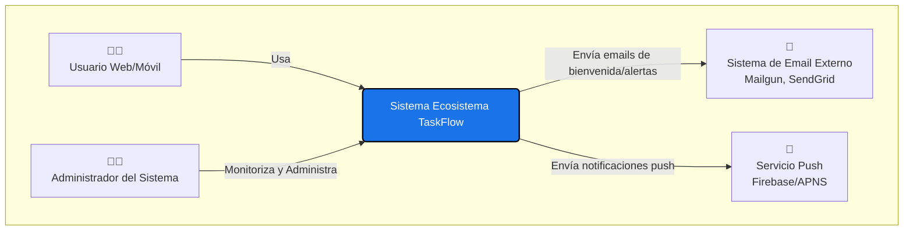
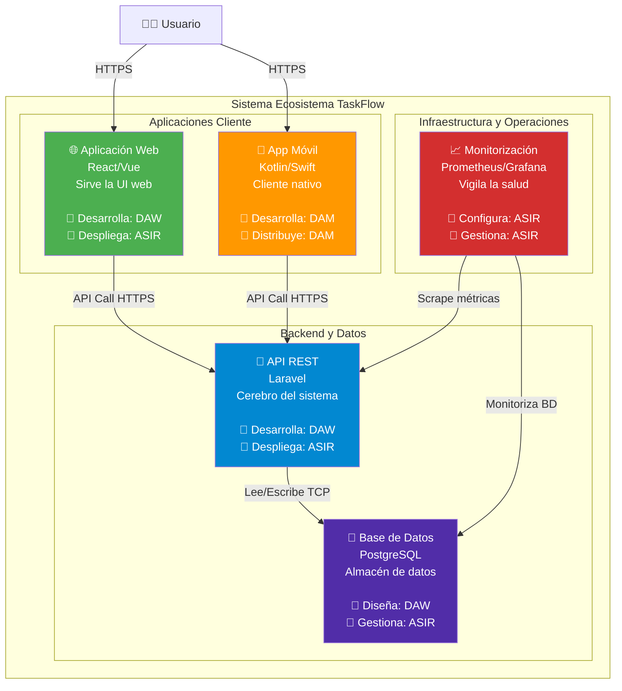

# 2. Diagramas de Alto Nivel

## Del Concepto al Dibujo

En el Capítulo 1 definimos la arquitectura de un proyecto, pero hay un problema: **esa descripción vive en texto, en nuestras cabezas**.

Si le preguntamos a un desarrollador de DAW Backend, a un desarrollador de DAM y a un ingeniero de ASIR que "dibujen la arquitectura del proyecto", probablemente obtendremos tres diagramas completamente diferentes. Cada uno enfatizará lo que le importa a su rol:

:::: tabs

== 📘 Perspectiva DAW

**DAW Backend** dibujará:

- Endpoints de API (rutas, métodos HTTP)
- Controladores y servicios
- Modelos de datos y migraciones
- Lógica de negocio y validaciones

**Enfoque:** La arquitectura como un conjunto de **responsabilidades de código**.

== 📗 Perspectiva DAM

**DAM** dibujará:

- Pantallas de usuario (views/activities)
- Flujos de navegación entre pantallas
- Cómo se conecta a la API (retrofit, fetch)
- Gestión de estados locales

**Enfoque:** La arquitectura como una **experiencia de usuario** conectada a servicios.

== 📕 Perspectiva ASIR

**ASIR** dibujará:

- Servidores físicos o virtuales (EC2, VPS)
- Redes, subredes y VPCs
- Balanceadores de carga y firewalls
- Estrategias de backup y monitorización

**Enfoque:** La arquitectura como **infraestructura desplegable**.

::::

¿Quién tiene razón? **Todos**. Pero necesitamos un lenguaje común para que estos tres diagramas "encajen".

Aquí es donde entran los **diagramas de alto nivel**. Su objetivo es que **todo el equipo** (DAW, DAM y ASIR) entienda cómo interactúa el sistema en su conjunto, antes de perderse en los detalles específicos de su tecnología.

## El Modelo C4 (Contexto, Contenedores)

El **Modelo C4** es un enfoque moderno y muy popular para visualizar arquitecturas de software. Su nombre viene de sus cuatro niveles: **C**ontexto, **C**ontenedores, **C**omponentes y **C**ódigo. Propone que no hay un "único" diagrama que sirva para todos, sino que debemos crear **diferentes vistas** con distintos niveles de zoom, como si usáramos Google Maps.

Para esta sesión, nos centraremos en los **dos niveles más altos**, que son cruciales para la alineación entre los equipos DAW, DAM y ASIR:

## Nivel 1: Diagrama de Contexto (Zoom más alejado)

**Propósito:** Muestra una "caja negra" de tu sistema completo y cómo interactúa con el mundo exterior: los **usuarios** (actores) y los **sistemas externos** (ej. una pasarela de pago, un servicio de email, otra API).

**Para quién es:** Para **todos**. Es la vista de "visión global" que unifica a negocio y a tecnología. El director del proyecto, el cliente y los tres equipos (DAW, DAM, ASIR) deben entender este diagrama sin necesidad de conocimientos técnicos profundos.

> [!NOTE]
> **¿Qué preguntas responde este diagrama?**
>
> - ¿Quiénes son los actores principales del sistema? (Usuarios finales, administradores, sistemas externos).
> - ¿Qué hace el sistema en su conjunto? (Sin entrar en detalles técnicos).
> - ¿Con qué servicios externos debe integrarse? (APIs de terceros, servicios de email, etc.).
>
> **Lo que NO muestra:** Tecnologías específicas, lenguajes de programación, o cómo está construido internamente el sistema. Es totalmente abstracto.

### **Ejemplo: Contexto del Ecosistema TaskFlow**

## Nivel 2: Diagrama de Contenedores (Primer nivel de zoom)

**Propósito:** "Abrimos" la caja negra del Nivel 1. Muestra los grandes "bloques" que componen el sistema. Un "contenedor" en C4 es una ***unidad desplegable y ejecutable*** como una aplicación web, una API, una base de datos o una app móvil.

> [!CAUTION] Confusión terminológica crítica: "Contenedor" ≠ Docker
>
> En el contexto del Modelo C4, un "contenedor" **NO** es específicamente un contenedor Docker, aunque *puede* ejecutarse dentro de uno.
>
> **Definición C4:** Un "contenedor" es cualquier **unidad de software que se ejecuta de forma independiente** y tiene su propia responsabilidad. Ejemplos:
>
> - Una **aplicación web** (React) que se ejecuta en un navegador.
> - Una **API REST** (Laravel) que se ejecuta en un servidor (sí, puede estar en Docker, pero no tiene por qué).
> - Una **app móvil** (Kotlin) que se ejecuta en un teléfono Android.
> - Una **base de datos** (PostgreSQL) que puede estar en un servidor físico, en la nube, o sí, en un contenedor Docker.

> [!NOTE]
> **Regla:** Si tiene su propio proceso, su propio espacio de memoria y se despliega de forma independiente, es un "contenedor" en C4. Docker es solo *una* de las muchas formas de ejecutarlo.

**Para quién es:** Es el diagrama **más importante** para los equipos técnicos (DAW, DAM, ASIR). Define:

- **Las responsabilidades de cada bloque:** "La API gestiona la lógica de negocio". "La Base de Datos almacena datos persistentes".
- **Las tecnologías específicas:** Laravel, PostgreSQL, React, Kotlin.
- **Las fronteras de coordinación:** DAW construye la API y la Web. DAM construye la App Móvil. ASIR despliega y monitoriza todos estos contenedores.

> [!IMPORTANT]
> **Este diagrama es el "contrato de coordinación" entre equipos**
>
> Cuando DAM pregunta "¿A dónde hago las peticiones HTTP?", la respuesta está aquí: "A la API REST en `https://api.taskflow.com`".
>
> Cuando ASIR pregunta "¿Qué componentes debo desplegar?", la respuesta está aquí: "La API, la Base de Datos, el Monitor, y un servidor web para la App Web".

### **Ejemplo: Contenedores del Ecosistema TaskFlow**

## Del Software a la Infraestructura: El Siguiente Nivel

Hasta aquí hemos diseñado la **arquitectura lógica** de TaskFlow:

- **Nivel 1 (Contexto):** Qué hace el sistema y con quién interactúa.
- **Nivel 2 (Contenedores):** Los bloques de software (API, Web, Móvil, BD) y cómo se comunican.

Pero aún falta responder una pregunta crítica: **¿Dónde se ejecuta todo esto físicamente?**

- ¿En servidores cloud (AWS, Azure) o en infraestructura propia (on-premise)?
- ¿Cómo se protege la red? ¿Qué reglas de firewall se aplican?
- ¿Cómo se configuran las IPs, subredes y VLANs?

Estas preguntas se responden con los **Diagramas de Despliegue** y los **Diagramas de Infraestructura de Red**.
