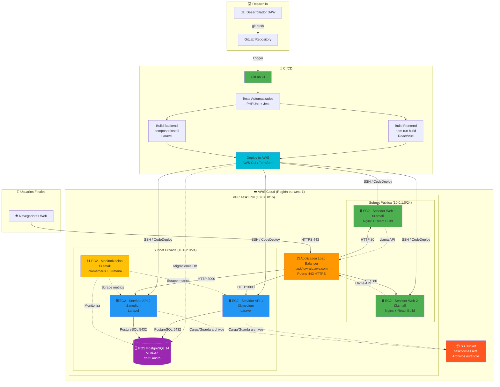
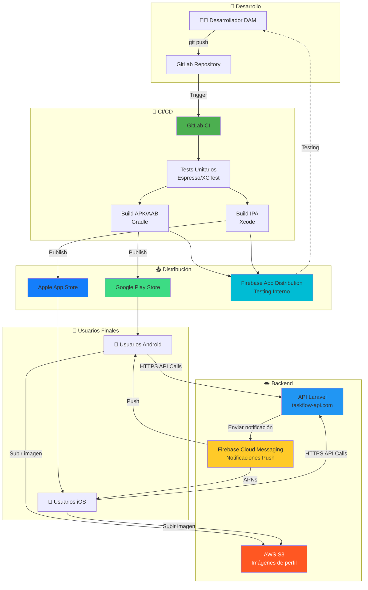
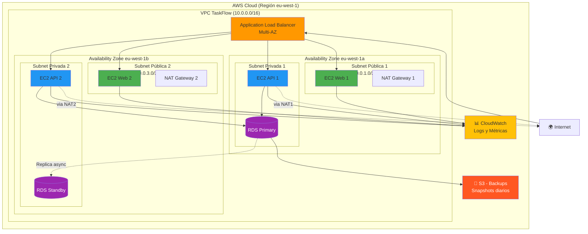
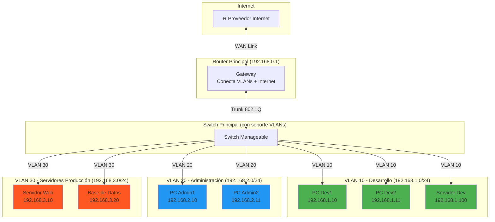

# 3. Diagramas de Despliegue e Infraestructura

## ¿Dónde Vive el Código?

En el Capítulo 2 diseñamos la arquitectura lógica con el Modelo C4:

- **Diagrama de Contexto:** ¿Qué hace el sistema y quién lo usa?
- **Diagrama de Contenedores:** ¿Qué bloques de software lo componen (API, Web, Móvil, BD)?

Pero hay una pregunta crítica que aún no hemos respondido: **¿Dónde se ejecuta todo esto físicamente?**

- ¿La API corre en un servidor propio o en la nube (AWS, Azure)?
- ¿Cuántas instancias hay? ¿Cómo se balancea la carga?
- ¿Cómo se protege la base de datos del acceso no autorizado?
- ¿Qué pasa con las redes físicas, los switches, los routers?

Aquí es donde entran los **Diagramas de Despliegue** y los **Diagramas de Infraestructura de Red**. Son el puente entre el diseño lógico (software) y la realidad física (hardware, redes, servidores).

> [!IMPORTANT]
> **Diferencias de enfoque por equipo:**
>
> - **DAW:** Se enfoca en **despliegue del backend (API) + frontend web** en arquitecturas cloud. Configuración de servidores, bases de datos, hosting estático, seguridad, CI/CD.
> - **DAM:** Se enfoca en **despliegue de aplicaciones móviles nativas** (Android/iOS). Distribución via App Stores, notificaciones push, integración con APIs cloud.
> - **ASIR:** Además del despliegue cloud completo, debe dominar **infraestructura física tradicional** (cableado, switches, routers, racks) e **infraestructura lógica de red** (IPs, subredes, VLANs).

-----

## Diagramas de Despliegue e Infraestructura por Equipo

:::: tabs

== 📘 DAW

**Como DAW, tu enfoque está en:**

1. **Backend API REST (Laravel):** Lógica de negocio, endpoints, autenticación
2. **Frontend Web (React/Vue):** Interfaz de usuario web, consumo de API
3. **Base de Datos (PostgreSQL):** Diseño de esquemas, migraciones, optimización
4. **Despliegue cloud:** Configuración de servidores, CI/CD, monitorización básica

### Diagrama de Despliegue (Deployment Diagram)

**Propósito:** Mapea los **contenedores del Capítulo 2** (API REST + Aplicación Web + Base de Datos) sobre la **infraestructura real en la nube**. Muestra dónde se ejecuta cada pieza de software y cómo se comunican entre sí a través de redes virtuales.

**Componentes clave:**

- **Instancias de cómputo:** Servidores virtuales (EC2 en AWS, VMs en Azure, Droplets en DigitalOcean).
- **Balanceadores de carga:** Distribuyen tráfico entre múltiples instancias (AWS ALB, Azure Load Balancer).
- **Bases de datos gestionadas:** Servicios cloud de BD (AWS RDS, Azure SQL Database).
- **Redes virtuales (VPCs):** Aíslan recursos en subredes públicas y privadas.
- **CDN y almacenamiento:** CloudFront (AWS), Azure CDN, S3/Blob Storage.

#### Arquitectura completa: Desarrollo, CI/CD y Despliegue de TaskFlow



**Elementos clave del diagrama:**

#### Fase 1: Desarrollo y CI/CD

1. **GitLab Repository:**
   - Código fuente del frontend (React/Vue) y backend (Laravel)
   - Control de versiones con Git
   - Dispara el pipeline automáticamente con cada `git push`

2. **GitLab CI Pipeline:**
   - Ejecuta tests automatizados (PHPUnit para Laravel, Jest para frontend)
   - Compila el frontend (`npm run build`)
   - Instala dependencias del backend (`composer install`)
   - Solo despliega si todos los tests pasan ✅

3. **Deploy to AWS:**
   - Usa AWS CLI o herramientas IaC (Terraform, AWS CodeDeploy)
   - Sube el build del frontend a los servidores web
   - Sube el código del backend a los servidores API
   - Ejecuta migraciones de base de datos automáticamente

#### Fase 2: Infraestructura en AWS

1. **Application Load Balancer (ALB):**
   - Punto de entrada único desde Internet
   - Distribuye tráfico entre Web Servers y API Servers
   - Termina conexiones SSL/TLS (HTTPS → HTTP interno)

2. **Subnet Pública:**
   - Contiene los servidores web (frontend)
   - Tiene acceso directo a Internet mediante Internet Gateway
   - **2 instancias** para alta disponibilidad

3. **Subnet Privada:**
   - Contiene API y Base de Datos
   - **NO accesible directamente desde Internet**
   - Solo accesible a través del ALB o desde la subnet pública

4. **RDS PostgreSQL Multi-AZ:**
   - Base de datos gestionada por AWS
   - Replicación automática en múltiples zonas de disponibilidad
   - Solo acepta conexiones desde la subnet privada

5. **S3 Bucket:**
   - Almacenamiento de archivos subidos por usuarios
   - Los servidores API guardan/recuperan archivos aquí

6. **Monitoring (Prometheus + Grafana):**
   - Recopila métricas de todos los servidores
   - Dashboards para visualizar CPU, memoria, latencia de API
   - Alertas automáticas si algún servicio falla

### Costos estimados (Región eu-west-1)

| Recurso | Especificación | Costo mensual (aprox.) |
|---------|----------------|------------------------|
| Application Load Balancer | 1 ALB | 16€ |
| EC2 Web Servers | 2x t3.small | 30€ |
| EC2 API Servers | 2x t3.medium | 60€ |
| EC2 Monitoring | 1x t3.small | 15€ |
| RDS PostgreSQL | db.t3.micro Multi-AZ | 40€ |
| S3 Storage | 50 GB + transferencia | 5€ |
| Transferencia de datos | Salida a Internet | 10€ |
| **TOTAL** | | **~176€/mes** |

== 📗 DAM

### Diagrama de Despliegue para Apps Nativas

**Como DAM, tu enfoque está en:**

1. **App móvil nativa Android (Kotlin):** Distribución via Google Play Store
2. **App móvil nativa iOS (Swift):** Distribución via Apple App Store
3. **Integración con servicios cloud:** Firebase Cloud Messaging, notificaciones push
4. **Testing y distribución interna:** Firebase App Distribution

**Arquitectura de distribución para TaskFlow Móvil:**



**Componentes clave:**

1. **GitLab CI / GitHub Actions:**
   - Compila la app automáticamente al hacer push
   - Ejecuta tests unitarios y de UI
   - Genera APKs firmados para Android y IPAs para iOS

2. **Firebase App Distribution:**
   - Distribuye builds de prueba a testers internos (QA)
   - Notifica al equipo cuando hay nueva versión disponible

3. **Google Play / App Store:**
   - Publicación final para usuarios reales
   - Proceso de revisión (~1-3 días App Store, ~horas Play Store)

4. **Firebase Cloud Messaging (FCM):**
   - Sistema unificado de notificaciones push
   - FCM traduce a APNs (Apple Push Notification service) para iOS

5. **AWS S3 / Firebase Storage:**
   - Almacenamiento de imágenes de perfil, archivos adjuntos
   - URLs firmadas para acceso seguro

### Costos estimados para DAM

| Servicio | Descripción | Costo mensual (aprox.) |
|----------|-------------|------------------------|
| Firebase Cloud Messaging | Notificaciones push ilimitadas | **Gratis** |
| Firebase App Distribution | Testing interno | **Gratis** |
| Firebase Crashlytics | Reporte de crashes | **Gratis** |
| Vercel (Frontend Web) | Hosting + CDN | **Gratis** (hobby) / 20€ (pro) |
| Google Play Console | Cuenta de desarrollador | **25€ una sola vez** |
| Apple Developer Program | Cuenta de desarrollador | **99€/año** |
| AWS S3 (almacenamiento) | Imágenes/archivos | 5€/mes |
| **TOTAL (mensual)** | | **~10€/mes** (sin contar cuota anual Apple) |

== 📕 ASIR

**Como ASIR, tu enfoque abarca tres capas:**

1. **Despliegue Cloud Completo** (backend + frontend/móvil + infraestructura avanzada)
2. **Infraestructura Física de Red** (hardware, cableado, topologías, datacenters)
3. **Infraestructura Lógica de Red** (direccionamiento IP, subredes, VLANs, protocolos, routing)

### 1. Diagrama de Despliegue Cloud (Visión Completa)

**Además de los diagramas de DAW (backend) y DAM (frontend/móvil), ASIR debe documentar:**

- **Zonas de disponibilidad (AZs):** Distribución geográfica para tolerancia a fallos
- **NAT Gateways:** Para que servidores en subnets privadas accedan a Internet (actualizaciones)
- **VPN / Direct Connect:** Conexión segura entre oficinas y la nube
- **Backup y Disaster Recovery:** Snapshots de RDS, replicación cross-region
- **Monitorización avanzada:** CloudWatch, alarmas, dashboards de Grafana

**Diagrama ampliado con zonas de disponibilidad:**



**Conceptos clave de alta disponibilidad:**

- **Multi-AZ:** Si la zona `eu-west-1a` falla (terremoto, corte eléctrico del datacenter), el sistema sigue funcionando en `eu-west-1b`.
- **NAT Gateways:** Permiten que los servidores en subnets privadas (sin IP pública) hagan peticiones salientes a Internet (ej. descargar paquetes npm, actualizar el sistema operativo).
- **Replicación de RDS:** La BD principal replica datos a la standby. Si falla, AWS automáticamente promociona la standby a principal (failover automático en ~60 segundos).

### 2. Infraestructura Física de Red

**Contexto:** Además del despliegue cloud, ASIR debe diseñar redes físicas tradicionales (ej. en oficinas, centros de datos propios, entornos on-premise).

#### Componentes Físicos de Red

| Componente | Función | Ejemplos |
|------------|---------|----------|
| **Cables** | Medio de transmisión de datos | UTP Cat5e/Cat6, Fibra óptica, Coaxial |
| **Switch** | Conecta dispositivos en la misma red local (LAN) | Cisco Catalyst, Netgear, HP ProCurve |
| **Router** | Conecta diferentes redes (ej. LAN con Internet) | Cisco ISR, MikroTik, pfSense |
| **Punto de Acceso (AP)** | Conectividad inalámbrica (WiFi) | Ubiquiti UniFi, Cisco Aironet |
| **Firewall** | Filtra tráfico según reglas de seguridad | pfSense, Fortinet, Palo Alto |
| **Rack** | Estructura para montar equipos | Rack 19" de 42U |
| **Panel de Parcheo** | Organiza conexiones de cables | Panel de 24/48 puertos |
| **UPS** | Alimentación ininterrumpida | APC Smart-UPS |

#### Topologías Físicas

##### 1. Topología en Estrella (la más común)

```plaintext
          [Switch Central]
         /      |       \
        /       |        \
     [PC1]    [PC2]    [Servidor]
```

- **Ventaja:** Si un cable falla, solo afecta a un dispositivo.
- **Desventaja:** Si el switch falla, toda la red cae (punto único de fallo).

##### 2. Topología en Bus (obsoleta)

```plaintext
[PC1]——[PC2]——[PC3]——[Servidor]
```

- **Desventaja:** Si el cable central se rompe, toda la red cae.

##### 3. Topología en Anillo

```plaintext
[PC1]——[PC2]
  |        |
[PC4]——[PC3]
```

- Usada en redes Token Ring (obsoleta) y en redes metropolitanas (MAN).

##### 4. Topología en Malla (para alta disponibilidad)

```plaintext
[Router1]—————[Router2]
    |  ╲       ╱  |
    |    ╲   ╱    |
    |      ╳      |
    |    ╱   ╲    |
    |  ╱       ╲  |
[Router3]—————[Router4]
```

- **Ventaja:** Múltiples rutas redundantes. Si un enlace falla, hay caminos alternativos.
- **Uso:** Redes de ISPs, datacenters críticos.

#### Diagrama Físico de una Oficina

**Escenario:** Oficina con 2 departamentos (Desarrollo y Administración), servidor de archivos y conexión a Internet.

```plaintext
                       [Internet]
                           |
                       [Router]
                           |
                   [Switch Principal]
                   /               \
                  /                 \
         [Switch Dpto.        [Switch Dpto.
          Desarrollo]          Administración]
            /      \              /       \
           /        \            /         \
      [PC Dev1]  [PC Dev2]  [PC Admin1] [Servidor Archivos]
```

**Detalles técnicos:**

- **Cable del Router al Switch Principal:** Fibra óptica (1 Gbps)
- **Cables de Switches a PCs:** UTP Cat6 (1 Gbps)
- **Servidor de Archivos:** Conectado directamente al switch de Administración

> [!TIP]
> **Buenas prácticas en cableado físico:**
>
> - Etiquetar todos los cables en ambos extremos
> - Usar canaletas para evitar cables sueltos
> - Documentar en panel de parcheo qué puerto conecta a qué ubicación
> - Separar cables de datos de cables eléctricos (evitar interferencias)

### 3. Infraestructura Lógica de Red

**La infraestructura lógica define CÓMO se comunican los dispositivos, independientemente de su ubicación física.**

#### Componentes Lógicos

| Concepto | Descripción | Ejemplo |
|----------|-------------|---------|
| **Dirección IP** | Identificador único de un dispositivo en la red | `192.168.1.10` |
| **Máscara de Subred** | Define qué IPs están en la misma red | `255.255.255.0` (/24) |
| **Gateway** | Puerta de salida a otras redes | `192.168.1.1` (router) |
| **DNS** | Traduce nombres de dominio a IPs | `8.8.8.8` (Google DNS) |
| **DHCP** | Asigna IPs automáticamente a dispositivos | Servidor DHCP en router |
| **VLAN** | Red virtual que segmenta tráfico | VLAN 10 (Desarrollo), VLAN 20 (Admin) |

#### Subredes (Subnetting)

**¿Por qué dividir redes en subredes?**

- Organizar dispositivos por departamento/función
- Mejorar seguridad (aislar tráfico)
- Optimizar rendimiento (reducir broadcast storms)

#### Ejemplo: Red empresarial con 3 subredes

| Subred | Dirección de Red | Rango de IPs | Máscara | Uso |
|--------|------------------|--------------|---------|-----|
| Administración | `192.168.1.0/24` | `192.168.1.1` - `192.168.1.254` | `255.255.255.0` | PCs de oficina |
| Desarrollo | `192.168.2.0/24` | `192.168.2.1` - `192.168.2.254` | `255.255.255.0` | Servidores de desarrollo |
| Servidores Producción | `192.168.3.0/24` | `192.168.3.1` - `192.168.3.254` | `255.255.255.0` | Servidores críticos |

#### VLANs (Virtual LANs)

**Concepto:** Segmentar lógicamente una red física en múltiples redes virtuales.

**Ejemplo:** Misma oficina física, 2 VLANs

```plaintext
         VLAN 10            VLAN 20
      (Desarrollo)       (Administración)
      192.168.1.0/24     192.168.2.0/24

[PC Dev1 - .1.10]         [PC Admin1 - .2.10]
[PC Dev2 - .1.11]         [PC Admin2 - .2.11]
          |                          |
          |                          |
        [Switch con soporte VLANs]
                    |
                [Router]
             (conecta ambas VLANs)
```

**Ventajas de VLANs:**

- Los PCs de Desarrollo NO pueden ver el tráfico de Administración (seguridad).
- Reduce el dominio de broadcast (mejor rendimiento).
- Facilita gestión (puedes mover un PC de VLAN sin cambiar cableado físico).

#### Diagrama Lógico Completo

**Escenario:** Oficina con 3 VLANs + conexión a Internet



**Reglas de firewall entre VLANs:**

| Origen | Destino | Acción | Justificación |
|--------|---------|--------|---------------|
| VLAN 10 (Dev) | VLAN 30 (Prod) | ✅ PERMITIR | Desarrolladores necesitan acceder a servidores de prueba |
| VLAN 20 (Admin) | VLAN 30 (Prod) | ❌ DENEGAR | Administradores NO necesitan acceso directo a servidores |
| VLAN 30 (Prod) | Internet | ✅ PERMITIR | Servidores necesitan actualizaciones |
| Internet | VLAN 30 (Prod) | ❌ DENEGAR | Servidores NO deben ser accesibles desde Internet directo |

### 4. Comparativa: Físico vs Lógico vs Despliegue Cloud

| Aspecto | Diagrama Físico | Diagrama Lógico | Diagrama Despliegue Cloud |
|---------|----------------|-----------------|---------------------------|
| **¿Qué muestra?** | Ubicación real de equipos y cables | Direccionamiento IP, VLANs, protocolos | Servicios cloud, subredes virtuales, regiones |
| **Enfoque** | Hardware tangible | Configuración de red | Infraestructura como servicio (IaaS) |
| **Elementos clave** | Switches, routers, racks, cables | IPs, máscaras, VLANs, rutas | EC2, RDS, VPCs, Security Groups |
| **Uso principal** | Instalación, cableado, mantenimiento físico | Configuración de routers/switches, segmentación | Arquitectura cloud, escalabilidad, seguridad virtual |
| **Herramientas** | Draw.io (iconos físicos) | Draw.io, Packet Tracer | Draw.io (iconos AWS/Azure), CloudCraft |
| **Ejemplo** | Cable UTP del puerto 3 del switch al PC del despacho 201 | PC `192.168.1.10` en VLAN 10, gateway `192.168.1.1` | EC2 en subnet privada `10.0.2.0/24`, conectada a RDS via Security Group |

> [!IMPORTANT]
> **Como ASIR, debes dominar los tres tipos:**
>
> - **Físico:** Para diseñar e instalar infraestructura on-premise (oficinas, CPDs propios).
> - **Lógico:** Para configurar dispositivos de red (routers, switches, firewalls).
> - **Cloud:** Para arquitecturas modernas, escalables y gestionadas por proveedores.

::::
