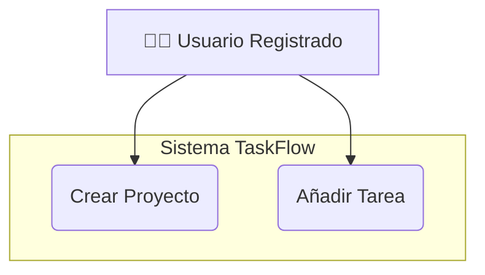
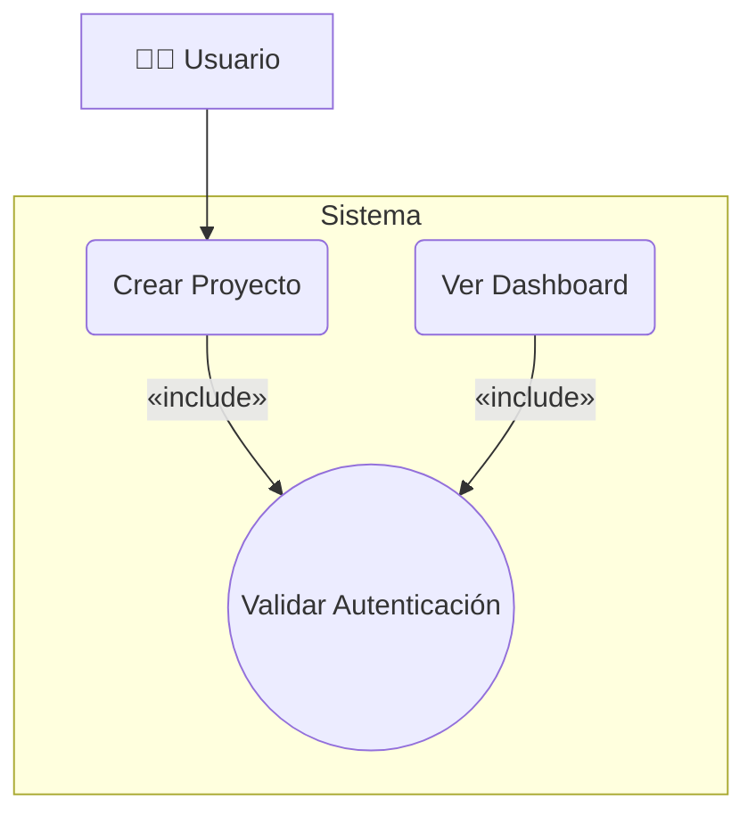
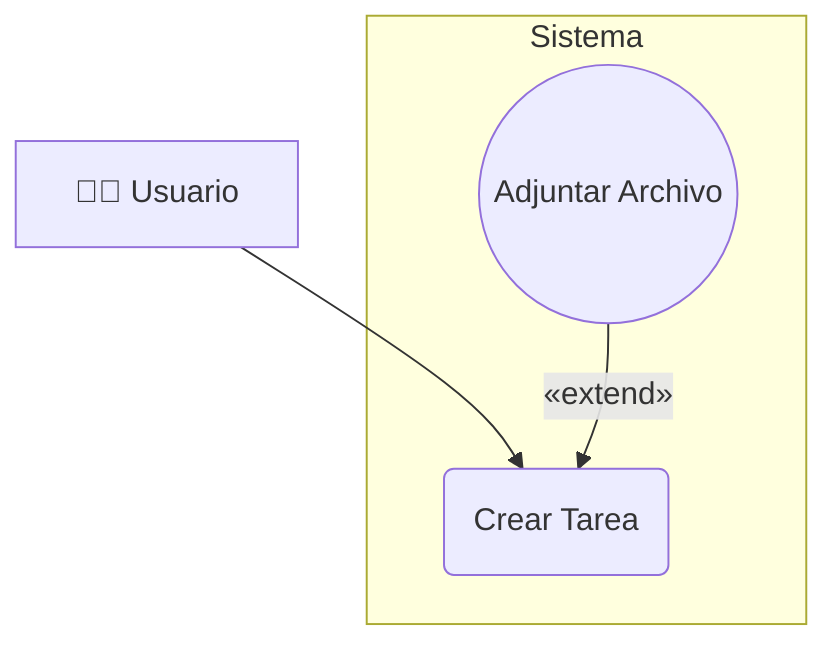
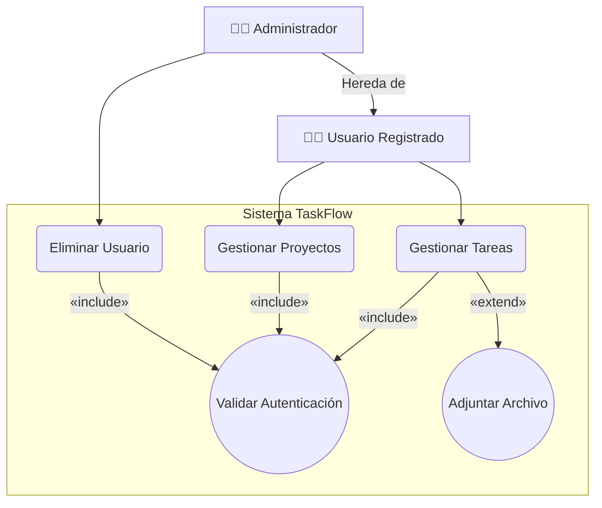

# 4. Diagrama de Casos de Uso

## ¿Qué Puede Hacer el Usuario?

En el Capítulo 3 diseñamos la **estructura de datos**: qué información guardamos y cómo se relaciona. Pero un sistema no es solo una colección de tablas. Los datos son estáticos; lo que da vida al sistema es el **comportamiento**: las acciones que los usuarios pueden realizar.

Ahora necesitamos responder a preguntas como:

- ¿Qué puede hacer un usuario registrado?
- ¿Qué funcionalidades son exclusivas de un administrador?
- ¿Qué acciones requieren que el usuario esté autenticado?
- ¿Qué funcionalidades son opcionales o condicionales?

El **Diagrama de Casos de Uso** es la conexión directa entre los **requisitos del cliente** (Historias de Usuario) y el **diseño funcional** del sistema.

**Enfoque:** Modela el **comportamiento funcional** del sistema desde la perspectiva del usuario. No responde al "cómo" técnico, sino al "**qué**" puede hacer el usuario.

> [!IMPORTANT] El Puente entre Negocio y Desarrollo
>
> Este diagrama es una herramienta de comunicación vital entre:
>
> - **El Product Owner / Cliente:** Define los requisitos ("Quiero que los usuarios puedan crear proyectos").
> - **Los equipos de desarrollo (DAW/DAM):** Diseñan e implementan esas funcionalidades.
>
> Un buen Diagrama de Casos de Uso garantiza que todos entiendan el alcance del sistema sin ambigüedades: qué está dentro del MVP (Producto Mínimo Viable) y qué queda fuera.

## Componentes Clave del Diagrama

### 1. Actor (El "Quién")

El **Actor** no es una persona específica, sino un **rol** que interactúa con el sistema. Puede ser un usuario humano o incluso otro sistema externo.

**Representación:** Una figura de "hombre de palo" (stick figure).

**Ejemplos en TaskFlow:**

- `Usuario Registrado`: Cualquier persona que tiene una cuenta en TaskFlow.
- `Administrador`: Un usuario con permisos especiales.
- `Sistema de Email Externo`: Un actor no humano que envía correos (técnicamente, es un sistema externo).

> [!WARNING]
> **Error común: Actores demasiado específicos**
>
> ❌ **Incorrecto:** "Guillermo Garrido (Usuario DAW)", "Javier Gimeno (Usuario ASIR)", "Alfredo Oltra (Administrador)".
>
> ✅ **Correcto:** "Administrador", "Usuario Registrado", "Sistema de Email Externo".
>
> El actor representa un **rol genérico**, no una persona concreta. Si "Guillermo" y "Javier" pueden hacer las mismas acciones, son el mismo actor.

### 2. Sistema (La Frontera)

Es una caja que define la **frontera** de nuestra aplicación. Todo lo que está *dentro* de la caja son las funcionalidades que vamos a construir. Todo lo que está *fuera* son los Actores (o sistemas externos).

**Representación:** Un rectángulo grande que engloba los casos de uso.

**¿Por qué es importante?** Define el **alcance** del proyecto. Si un caso de uso está dentro de la caja, es nuestra responsabilidad implementarlo. Si está fuera, es responsabilidad de otro sistema (o no se implementa en esta fase).

### 3. Caso de Uso (El "Qué")

Es la **acción** o **meta** principal que un Actor quiere lograr. Debe aportar un **valor observable** al Actor.

**Representación:** Un óvalo con un nombre de acción (verbo + sustantivo).

**Ejemplos en TaskFlow:**

- `Crear Proyecto`
- `Iniciar Sesión`
- `Mover Tarea`
- `Exportar Informe`

> [!WARNING]
> **Error común: Casos de Uso técnicos en lugar de funcionales**
>
> Un caso de uso debe describir **qué quiere lograr el usuario**, no **cómo** lo logra técnicamente.
>
> ❌ **Incorrecto (técnico):** "Enviar petición POST a /api/projects".
>
> ✅ **Correcto (funcional):** "Crear Proyecto".
>
> El usuario no piensa en términos de endpoints HTTP. Piensa en términos de objetivos: "Quiero crear un proyecto". Los detalles técnicos (POST, GET, endpoints) pertenecen al Diagrama de Secuencia, no aquí.

**Ejemplo Básico de Componentes:**

## Relaciones entre Casos de Uso: El Poder de la Organización

Aquí es donde el diagrama gana verdadera potencia. Las líneas no son solo flechas decorativas; tienen significados muy específicos que nos ayudan a organizar la lógica del sistema y evitar la duplicación.

Las tres relaciones principales son: `<<include>>`, `<<extend>>` y **Generalización**. La confusión entre `include` y `extend` es una de las fuentes más comunes de errores en Casos de Uso, así que vamos a clarificarlas con precisión.

### 🔗 `<<include>>` (Inclusión / Prerequisito Obligatorio)

**Definición:** Indica una funcionalidad que es **obligatoria e inevitable** para que otro caso de uso se complete. El caso base está *incompleto* y **no puede ejecutarse** sin el caso incluido.

**Cuándo usarlo:** Para reutilizar lógica que es un **prerrequisito mandatorio** común a múltiples casos de uso.

**Ejemplo en TaskFlow:** Para `Crear Proyecto`, el usuario **debe** estar autenticado. No existe la posibilidad de crear un proyecto sin autenticarse primero. Por lo tanto, `Crear Proyecto` `<<include>>` `Validar Autenticación`.

**Dirección de la flecha:** Desde el caso base (el que necesita) → hacia el caso incluido (el necesario).

### 🔗 `<<extend>>` (Extensión / Funcionalidad Opcional)

**Definición:** Indica una funcionalidad que es **opcional y condicional**. "Extiende" el comportamiento de otro caso de uso, pero **solo si se cumple una condición específica**. El caso base *puede funcionar perfectamente* por sí solo, sin necesidad de la extensión.

**Cuándo usarlo:** Para funcionalidades que no siempre ocurren, que son "bonificaciones" o características adicionales que se activan bajo ciertas circunstancias.

**Ejemplo en TaskFlow:** `Crear Tarea` es el caso base. `Adjuntar Archivo` es una extensión opcional. El usuario puede crear y gestionar tareas sin adjuntar archivos. Solo **a veces** decide adjuntar un archivo.

**Dirección de la flecha:** Desde el caso opcional (extensión) → hacia el caso base (el que es extendido).

> [!NOTE]
> **Tabla Comparativa: `<<include>>` vs. `<<extend>>`**
>
> Esta es la confusión más común en Casos de Uso. Aquí está la diferencia definitiva:
>
> | Característica | `<<include>>` | `<<extend>>` |
> |---------------|---------------|--------------|
> | **Obligatoriedad** | Obligatorio (siempre ocurre) | Opcional (solo a veces) |
> | **Dependencia** | El caso base NO funciona sin él | El caso base funciona perfectamente solo |
> | **Dirección de la flecha** | Caso base → Caso incluido | Caso opcional → Caso base |
> | **Ejemplo** | "Crear Proyecto" `<<include>>` "Validar Autenticación" | "Adjuntar Archivo" `<<extend>>` "Gestionar Tareas" |
> | **Pregunta clave** | "¿El caso base está incompleto sin esto?" | "¿Esto es un extra opcional que a veces añade valor?" |

### 🔗 Generalización (Herencia de Roles)

**Definición:** Igual que en la programación orientada a objetos, un Actor (o un Caso de Uso) puede "heredar" las capacidades de otro.

**Cuándo usarlo:** Para definir jerarquías de roles. Si un actor puede hacer todo lo que hace otro actor, **y además** tiene capacidades propias, usa Generalización.

**Ejemplo en TaskFlow:** Un `Administrador` **es un tipo de** `Usuario Registrado`. Esto significa que el `Administrador` puede hacer **todo lo que hace un Usuario Registrado** (crear proyectos, gestionar tareas, ver dashboard), **y además** tiene casos de uso exclusivos (como `Eliminar Usuario` o `Ver Estadísticas Globales`).

**Dirección de la flecha:** Una flecha con un triángulo vacío que apunta desde el hijo (el rol especializado) → hacia el padre (el rol general).

-----

### **Ejemplo Completo: Casos de Uso del Ecosistema TaskFlow**

Este diagrama combina todo lo que hemos aprendido.

## De las Historias de Usuario a los Casos de Uso

Los Diagramas de Casos de Uso no se crean en el vacío. Son la formalización de los **requisitos funcionales** que el Product Owner (o el cliente) ha definido, normalmente en forma de **Historias de Usuario**.

### Ejemplo de Transformación

**Historia de Usuario (formato ágil):**

> Como **usuario registrado**, quiero **crear un nuevo proyecto**, para poder **organizar mis tareas en diferentes áreas de trabajo**.

**Se transforma en:**

- **Actor:** `Usuario Registrado`
- **Caso de Uso:** `Crear Proyecto`
- **Relación:** `Crear Proyecto` `<<include>>` `Validar Autenticación` (porque solo usuarios autenticados pueden crear proyectos)

**Historia de Usuario adicional:**

> Como **usuario**, al crear un proyecto, quiero **poder adjuntar una imagen de portada**, para **personalizarlo visualmente**.

**Se transforma en:**

- **Caso de Uso:** `Adjuntar Imagen de Portada`
- **Relación:** `Adjuntar Imagen de Portada` `<<extend>>` `Crear Proyecto` (porque es opcional, no todos los proyectos necesitan una imagen)

:::: tabs

== 📘 DAW Backend

**DAW Backend** usa este diagrama para:

- Identificar **qué endpoints crear** en la API (cada caso de uso = uno o más endpoints)
- Planificar **controladores y servicios** necesarios
- Definir **políticas de autorización** (¿quién puede ejecutar este caso de uso?)
- Estimar **esfuerzo de desarrollo** por funcionalidad

**Ejemplo:** Si "Crear Proyecto" está en el diagrama → Necesito `POST /api/projects`.

== 📗 DAM y DAW frontend

**DAM** usa este diagrama para:

- Diseñar **pantallas y flujos de navegación** (cada caso de uso = una o más pantallas)
- Identificar **qué llamadas a la API** necesita hacer
- Planificar **funcionalidades offline** (¿qué casos de uso funcionan sin conexión?)
- Priorizar **desarrollo de features** en sprints

**Ejemplo:** Si "Crear Proyecto" está en el diagrama → Necesito una pantalla con formulario + botón "Crear".

== 📕 ASIR

**ASIR** usa este diagrama para:

- Estimar **carga de la infraestructura** (¿cuántas funcionalidades simultáneas?)
- Planificar **pruebas de rendimiento** (simular usuarios ejecutando casos de uso)
- Configurar **logs y monitorización** (¿qué acciones críticas monitorizar?)
- Diseñar **respaldos** (¿qué casos de uso afectan datos críticos?)

**Ejemplo:** Si "Crear Proyecto" es un caso de uso frecuente → Debo monitorizar el tiempo de respuesta de ese endpoint.

== 🎯 Product Owner

**El Product Owner** usa este diagrama para:

- **Priorizar funcionalidades:** "¿Este caso de uso va en el Sprint 1 o el Sprint 3?"
- **Validar alcance:** "¿Esto que estoy pidiendo está dentro del MVP o es una mejora futura?"
- **Comunicar con stakeholders:** Mostrar qué funcionalidades tendrá el sistema sin jerga técnica
- **Negociar con el equipo:** "Si quitamos este caso de uso, ¿cuánto tiempo ahorramos?"

::::

Pero este diagrama responde al "**qué**" puede hacer el usuario, no al "**cómo**" lo hace el sistema internamente. Para eso necesitamos el último tipo de diagrama: el **Diagrama de Secuencia**.
