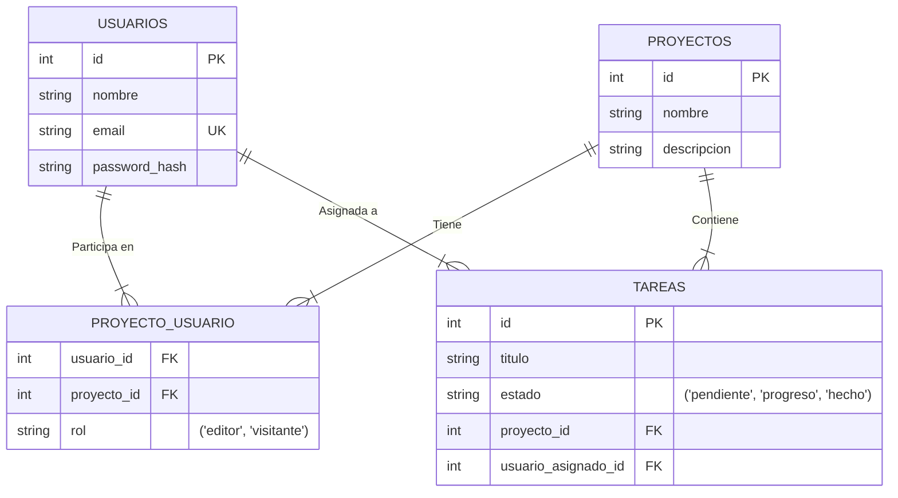

# 5. Diagrama de Entidad-Relación (ERD)

## Del Ecosistema a los Datos

En el Capítulo 2 diseñamos la arquitectura externa: cómo los usuarios interactúan con el sistema, cómo los contenedores se comunican entre sí, y dónde se despliega cada componente. Pero aún no hemos respondido a una pregunta fundamental: **¿Qué información guarda exactamente el sistema y cómo se estructura?**

Esta pregunta es crítica porque cada equipo necesita el ERD para diferentes propósitos:

:::: tabs

== 📘 Importancia para DAW

**DAW Backend** necesita el ERD para:

- Crear las **migraciones de base de datos** (SQL/Laravel migrations)
- Definir los **modelos Eloquent/ORM** con sus relaciones
- Diseñar los **endpoints de la API** basados en las entidades
- Implementar **validaciones** según los tipos de datos

**Sin el ERD:** Imposible implementar la persistencia de datos.

== 📗 Importancia para DAM

**DAM** necesita el ERD para:

- Entender **qué datos puede pedir a la API** (no puede pedir datos que no existen)
- Diseñar el **modelo de datos local** (Room, Realm, SQLite)
- Planificar la **sincronización offline** (¿qué tablas necesito replicar?)
- Crear las **clases de modelo** (DTOs, entities) en Kotlin/Swift

**Sin el ERD:** La app móvil no sabrá qué estructura esperar de la API.

== 📕 Importancia para ASIR

**ASIR** necesita el ERD para:

- Calcular el **tamaño de almacenamiento** necesario (¿cuántas filas estimadas?)
- Configurar **índices de rendimiento** (¿qué consultas serán frecuentes?)
- Diseñar la **estrategia de backups** (¿qué tablas son críticas?)
- Optimizar **consultas lentas** (identificando joins costosos)

**Sin el ERD:** Imposible planificar la infraestructura de base de datos.

::::

Si la API es el "cerebro" del sistema, la base de datos es el "corazón". El **Diagrama de Entidad-Relación (ERD)** es el plano universal para diseñar ese corazón.

**Enfoque:** Modela la **estructura lógica de los datos**. Responde a tres preguntas fundamentales:

1. **¿Qué información guardamos?** (Entidades: Usuarios, Proyectos, Tareas).
2. **¿Cómo se organiza?** (Atributos: nombre, email, fecha_creacion).
3. **¿Cómo se conecta?** (Relaciones: Un Proyecto contiene muchas Tareas).

## Componentes Clave del ERD

### 1. Entidades (Las "Cosas" que Existen)

Una **Entidad** es cualquier "cosa" u objeto del mundo real sobre el que queremos almacenar información. En un ERD, se convierte en una **tabla** de la base de datos.

**Ejemplos en TaskFlow:**

- `USUARIOS`: Representa a las personas que usan TaskFlow.
- `PROYECTOS`: Representa los proyectos que los usuarios crean.
- `TAREAS`: Representa las tareas dentro de cada proyecto.

> [!TIP] Analogía: Entidades como Sustantivos
>
> Piensa en las entidades como los **sustantivos** de tu sistema. Si puedes decir "un usuario", "un proyecto", "una tarea", entonces probablemente es una entidad.
>
> **Pregunta clave:** ¿Necesito guardar información sobre esto? Si la respuesta es sí, es una entidad. Si solo es un dato descriptivo de otra cosa (ej. "el color de fondo de la tarea"), entonces es un atributo, no una entidad.

### 2. Atributos (Las Características de las Cosas)

Los **Atributos** son las propiedades o características de una entidad. Se convierten en las **columnas** de la tabla.

**Ejemplos para la entidad `USUARIOS`:**

- `id`: Un número único que identifica al usuario (ej. 1, 2, 3...).
- `nombre`: El nombre del usuario (ej. "Ana García").
- `email`: Su correo electrónico (ej. "ana\@taskflow.com").
- `password_hash`: La contraseña cifrada (NUNCA guardamos contraseñas en texto plano).
- `fecha_registro`: Cuándo se registró (ej. "2025-11-05").

### 3. Claves (El Pegamento de las Relaciones)

Las claves son atributos especiales que se usan para **identificar** y **conectar** los datos entre tablas. Son la base de las bases de datos relacionales.

#### Clave Primaria (Primary Key - PK)

Es el identificador **único e irrepetible** de una fila dentro de una tabla. Garantiza que cada registro es distinguible de todos los demás.

**Características:**

- **Unicidad:** No puede haber dos filas con el mismo valor de PK.
- **Obligatoria:** No puede ser `NULL` (vacía).
- **Inmutable:** Idealmente, no debería cambiar nunca después de ser asignada.

**Ejemplo:** En la tabla `USUARIOS`, el atributo `id` es la PK. Si Ana tiene `id = 5`, ningún otro usuario puede tener `id = 5`.

#### Clave Foránea (Foreign Key - FK)

Es un atributo que **"apunta"** a la Clave Primaria de *otra* tabla. Es el "pegamento" que crea las relaciones entre entidades.

**Ejemplo:** La entidad `TAREAS` tiene un atributo `proyecto_id` (FK) que apunta al `id` (PK) de la tabla `PROYECTOS`. Esto significa: "Esta tarea pertenece a ese proyecto específico".

```sql
-- Ejemplo: Una tarea que pertenece al proyecto con id = 3
INSERT INTO tareas (id, titulo, proyecto_id) 
VALUES (101, 'Diseñar mockups', 3);
-- Esta tarea está vinculada al proyecto con id = 3
```

### 4. Cardinalidad (¿Cuántos se Relacionan con Cuántos?)

La **Cardinalidad** define la naturaleza numérica de una relación: "¿Cuántos elementos de la entidad A se relacionan con cuántos de la entidad B?". Es crítica porque determina cómo se implementará la relación en SQL.

#### Relación Uno a Uno (1:1)

**Definición:** Un elemento de A se relaciona con exactamente un elemento de B, y viceversa.

**Ejemplo:** Un `USUARIO` tiene un único `PERFIL_DETALLADO` (con biografía, foto de portada, redes sociales). Y ese perfil pertenece a un único usuario.

**Implementación:** Se añade una FK en cualquiera de las dos tablas, pero se marca como `UNIQUE` para garantizar la unicidad.

**¿Cuándo usarla?** Es poco común. Generalmente, si la relación es 1:1, puedes considerar fusionar ambas entidades en una sola tabla.

#### Relación Uno a Muchos (1:N)

**Definición:** Un elemento de A se relaciona con muchos elementos de B, pero un elemento de B solo se relaciona con un elemento de A.

**Ejemplo:** Un `PROYECTO` contiene muchas `TAREAS`. Pero una `TAREA` pertenece a un solo `PROYECTO`.

**Implementación:** La tabla del lado "muchos" (TAREAS) tiene una FK que apunta al lado "uno" (PROYECTOS).

```sql
-- Tabla PROYECTOS
CREATE TABLE proyectos (
    id INT PRIMARY KEY,
    nombre VARCHAR(100)
);

-- Tabla TAREAS (el lado "muchos")
CREATE TABLE tareas (
    id INT PRIMARY KEY,
    titulo VARCHAR(200),
    proyecto_id INT,  -- FK que apunta a proyectos.id
    FOREIGN KEY (proyecto_id) REFERENCES proyectos(id)
);
```

**¿Cuándo usarla?** Es la relación **más común** en bases de datos. Úsala cuando haya una jerarquía clara de "contención" o "pertenencia".

#### Relación Muchos a Muchos (N:M)

**Definición:** Muchos elementos de A se relacionan con muchos de B, y viceversa.

**Ejemplo:** Muchos `USUARIOS` participan en muchos `PROYECTOS`. Un usuario puede estar en 5 proyectos, y un proyecto puede tener 10 usuarios.

> [!CAUTION] El Error Crítico: Intentar Implementar N:M Directamente
>
> **Error común de principiante:** Intentar añadir una FK `usuarios_id` en la tabla `PROYECTOS` o una FK `proyectos_id` en la tabla `USUARIOS`. **Esto NO funciona** para relaciones N:M.
>
> **¿Por qué?** Una FK es un campo de una sola columna. Solo puede almacenar **un valor**. Si un proyecto tiene 10 usuarios, ¿cómo guardas 10 IDs en una sola columna? No puedes.
>
> **Solución obligatoria:** Crear una **tabla intermedia** (también llamada "tabla pivote").

**Implementación correcta con tabla pivote:**

```sql
-- Tabla USUARIOS
CREATE TABLE usuarios (
    id INT PRIMARY KEY,
    nombre VARCHAR(100)
);

-- Tabla PROYECTOS
CREATE TABLE proyectos (
    id INT PRIMARY KEY,
    nombre VARCHAR(100)
);

-- Tabla PROYECTO_USUARIO (la tabla pivote)
CREATE TABLE proyecto_usuarios (
    usuario_id INT,
    proyecto_id INT,
    rol VARCHAR(50),  -- 'editor', 'visitante'
    PRIMARY KEY (usuario_id, proyecto_id),  -- Clave primaria compuesta
    FOREIGN KEY (usuario_id) REFERENCES usuarios(id),
    FOREIGN KEY (proyecto_id) REFERENCES proyectos(id)
);
```

> [!NOTE] Como nombrar la tabla pivote
>
> Es buena práctica nombrar la tabla pivote combinando los nombres de las dos tablas que conecta, en orden alfabético (ej. `proyecto_usuarios`). Esto mejora la legibilidad y consistencia en el diseño de la base de datos.

**Cómo funciona:** La tabla `PROYECTO_USUARIO` tiene dos FKs. Cada fila representa una "membresía": "El usuario 5 participa en el proyecto 3 con rol 'editor'".

## Aplicación Práctica: ERD Completo de TaskFlow

Ahora que conocemos todos los componentes, diseñemos el ERD completo del ecosistema TaskFlow. Este diagrama implementa:

- Una relación **1:N** entre `PROYECTOS` y `TAREAS` (un proyecto contiene muchas tareas).
- Una relación **N:M** entre `USUARIOS` y `PROYECTOS` (mediante la tabla pivote `PROYECTO_USUARIO`).
- Una relación **1:N** entre `USUARIOS` y `TAREAS` (un usuario puede tener muchas tareas asignadas).


