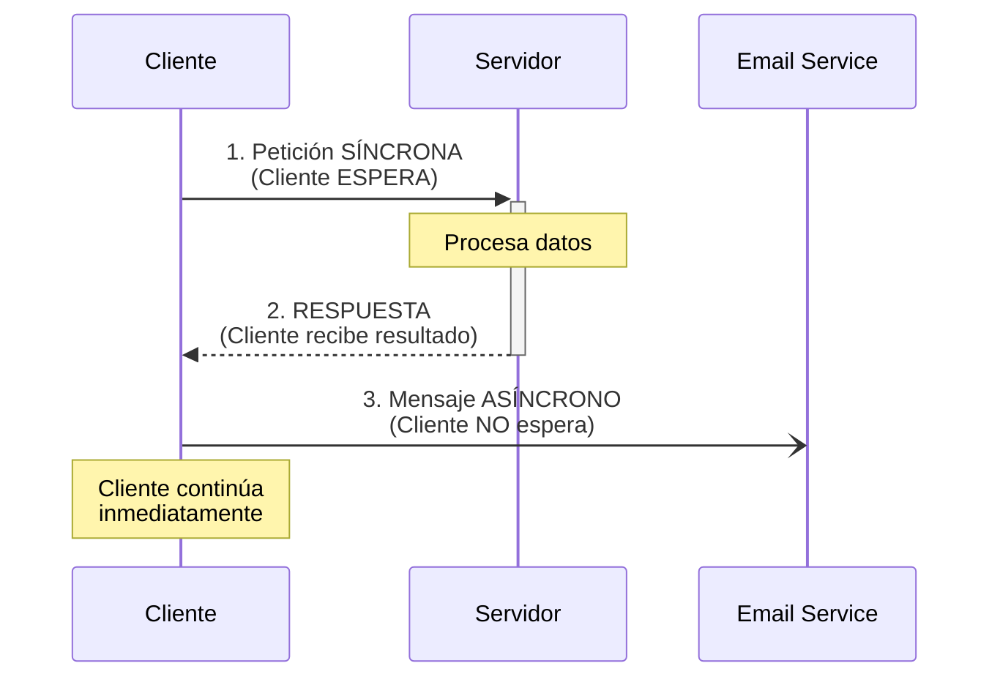
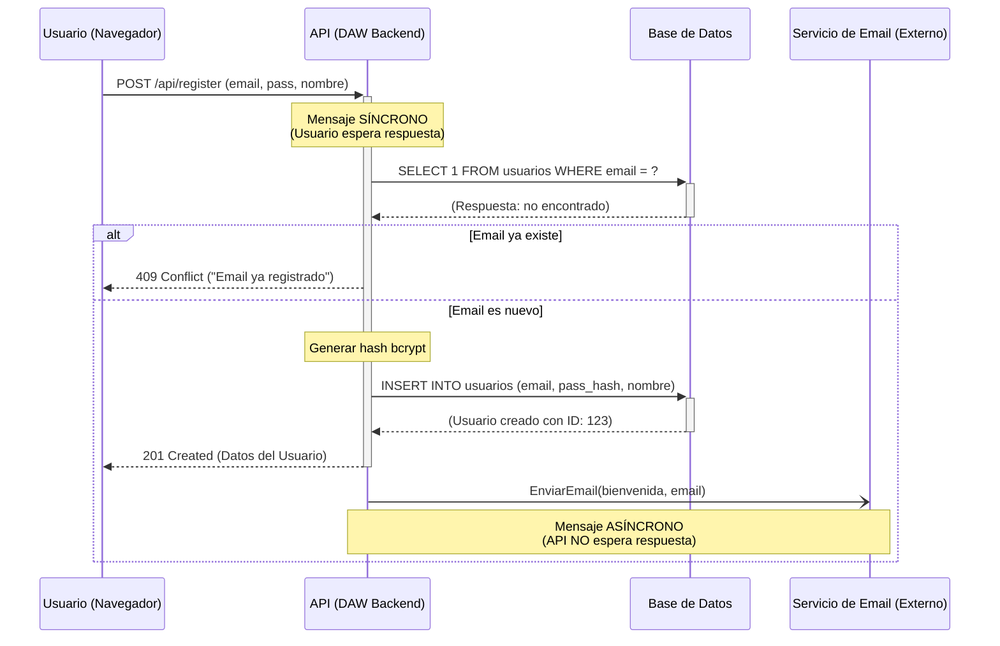

# 6. Diagrama de secuencia

## Del "Qué" al "Cómo"

En el Capítulo 4 diseñamos **qué puede hacer el usuario**: crear proyectos, gestionar tareas, adjuntar archivos. Pero ese diagrama no responde a las preguntas técnicas que los desarrolladores necesitan resolver:

- Cuando un usuario hace clic en "Crear Proyecto", ¿qué sucede exactamente?
- ¿En qué orden se ejecutan las operaciones?
- ¿Qué componentes se comunican entre sí?
- ¿Qué pasa si el email del usuario ya existe en la base de datos?
- ¿El sistema espera a que el email de bienvenida se envíe, o continúa inmediatamente?

Estas preguntas requieren un nivel de detalle temporal y técnico que el Diagrama de Casos de Uso no proporciona. Necesitamos ver el **flujo cronológico de mensajes** entre los componentes.

Aquí es donde entra el **Diagrama de Secuencia**.

**Enfoque:** Modela la **interacción temporal** entre los componentes del sistema. Es un diagrama dinámico que muestra el **orden exacto** de los mensajes a lo largo del tiempo, como si fuera la partitura musical de una orquesta donde cada instrumento (componente) toca su parte en el momento preciso.

> [!IMPORTANT] El Plano de Implementación para DAW y DAM
>
> Este es el diagrama más técnico de todos, y es la herramienta fundamental para:
>
> - **DAW Backend:** Diseñar la lógica interna de los endpoints de la API (qué consultas SQL ejecutar, en qué orden, qué validaciones hacer).
> - **DAW Frontend y DAM:** Entender exactamente cómo consumir la API (qué endpoint llamar, qué datos enviar, qué respuestas esperar).
>
> Si el Diagrama de Casos de Uso es "el contrato de funcionalidades", el Diagrama de Secuencia es "el manual de implementación".

## Componentes Clave del Diagrama

### 1. Líneas de Vida (Lifelines) - Los Actores del Escenario

Representan a los **participantes** (componentes, objetos, o incluso actores) que forman parte de la interacción. Cada participante tiene una línea vertical discontinua debajo de él que representa su "existencia" a lo largo del tiempo.

**Representación:** Un rectángulo con el nombre del componente en la parte superior, seguido de una línea vertical punteada.

**Ejemplos en TaskFlow:**

- `Usuario (Navegador)` o `App Móvil`: El cliente que inicia la petición.
- `API (Backend)`: El servidor que procesa la lógica de negocio.
- `Base de Datos`: El almacén de datos persistentes.
- `Servicio de Email`: Un sistema externo que envía correos.

> [!NOTE]
> **¿Qué nivel de detalle usar?**
>
> La granularidad de los participantes depende de tu objetivo:
>
> - **Diagrama de alto nivel (para coordinación entre equipos):** `Usuario`, `API`, `Base de Datos`.
> - **Diagrama de bajo nivel (para implementación):** `Controller`, `UserService`, `DatabaseConnection`, `EmailQueue`.

### 2. Bloques de Activación (Activation Boxes) - El Tiempo de Trabajo

Es un rectángulo estrecho sobre la Línea de Vida de un participante. Indica el **período de tiempo** durante el cual ese participante está **activo** o "trabajando" (ejecutando una operación).

**Representación:** Un rectángulo vertical delgado sobre la línea de vida.

**Interpretación:** Cuando un componente tiene su bloque de activación visible, significa que está "haciendo algo" (ejecutando código, procesando datos, esperando una respuesta). Cuando el bloque termina, el componente vuelve al estado de reposo.

### 3. Mensajes (La Comunicación entre Componentes)

Son las **flechas** que conectan las Líneas de Vida. Representan la comunicación entre los componentes. El tipo de flecha tiene un significado técnico muy preciso.

#### Ejemplo visual de los tipos de mensajes



#### Mensaje Síncrono (Llamada Bloqueante)

**Representación visual:** Flecha **sólida** (línea continua)

**Significado:** El emisor envía el mensaje y **se detiene (bloquea)** esperando una respuesta antes de continuar con su ejecución. Es la llamada más común en programación.

**Ejemplos:**

- Una petición HTTP `POST /api/register` desde el navegador a la API. El navegador se queda "esperando" (mostrando un spinner) hasta que la API responde.
- Una consulta SQL `SELECT * FROM usuarios WHERE email = ?`. El código que ejecuta la consulta se pausa hasta que la base de datos devuelve los resultados.

#### Mensaje Asíncrono (Llamada No Bloqueante)

**Representación visual:** Flecha con **línea discontinua** (⇢)

**Significado:** El emisor envía el mensaje y **continúa inmediatamente** con su trabajo, sin esperar una respuesta. La respuesta llegará "en algún momento" (o puede que nunca llegue, y el emisor no se da cuenta).

**Ejemplos:**

- "Enviar email de bienvenida". La API encola el email en un servicio externo (como SendGrid) y continúa inmediatamente. No espera a que el email sea efectivamente enviado.
- "Registrar evento en un log". El sistema escribe un mensaje en un archivo de log y sigue adelante.

#### Mensaje de Retorno (Respuesta)

**Representación visual:** Flecha con **línea discontinua** (←)

**Significado:** Muestra la respuesta de un mensaje. Devuelve datos al componente que llamó.

-----

## Fragmentos: Añadiendo Lógica de Control al Flujo

Un diagrama de secuencia no es solo una línea recta de mensajes. El código real tiene condicionales (`if-else`), bucles (`for`, `while`) y lógica de control. Los **fragmentos** son cajas especiales que nos permiten modelar esa lógica.

### 🔗 `alt` (Alternativas / if-else)

El fragmento `alt` (alternative) modela lógica condicional: **"si ocurre X, haz A; si no, haz B"**.

**Estructura:** La caja `alt` se divide en secciones separadas por una línea discontinua. Cada sección representa un escenario **mutuamente excluyente**. Solo una de las secciones se ejecutará.

**Ejemplo conceptual:**

```text
alt [Email ya existe en BD]
    API → Usuario: 409 Conflict ("Email ya registrado")
else [Email es nuevo]
    API → BD: INSERT INTO usuarios...
    API → Usuario: 201 Created
end
```

### 🔗 `loop` (Bucle / for-each)

El fragmento `loop` modela una secuencia de mensajes que **se repite** varias veces.

**Estructura:** La caja `loop` contiene la condición de repetición (ej. "Para cada elemento de X") y los mensajes que se repiten en cada iteración.

**Ejemplo conceptual:**

```text
loop [Para cada tarea del proyecto]
    API → BD: SELECT * FROM tareas WHERE proyecto_id = ?
    BD → API: Devuelve datos de la tarea
end
```

-----

## Ejemplo Completo: Registro de Usuario en TaskFlow

Ahora que conocemos todos los componentes, diseñemos el diagrama de secuencia completo para el caso de uso **"Registro de Usuario"** que vimos en el Capítulo 4.

Este diagrama responde a las preguntas técnicas:

1. ¿Qué endpoint llama el cliente? → `POST /api/register`
2. ¿Qué validaciones hace la API? → Verifica que el email no exista.
3. ¿Qué ocurre si el email ya está registrado? → Devuelve un error 409.
4. ¿Qué hace la API si el email es nuevo? → Inserta el usuario en la BD, devuelve 201, y envía un email asíncrono.
5. ¿El usuario espera a que el email se envíe? → No, el email se procesa en segundo plano.

**Participantes:**

- `Usuario (Navegador)`: El cliente web (DAW Frontend).
- `API (DAW Backend)`: El servidor que procesa la lógica.
- `Base de Datos`: PostgreSQL gestionada por ASIR.
- `Servicio de Email (Externo)`: SendGrid o similar.



:::: tabs

== 📘 DAW Backend

**DAW Backend** usa este diagrama como blueprint para:

- Definir la **lógica del controlador** (validaciones, consultas SQL, respuestas)
- Identificar **dónde usar transacciones** (si hay múltiples inserts/updates)
- Decidir **qué operaciones son síncronas vs asíncronas** (email en background)
- Documentar **códigos HTTP de respuesta** (201, 409, 500)

**Patrón de implementación:**

```text
1. Recibir request → Validar datos
2. Consultar BD (await) → Verificar duplicados
3. Si duplicado → return 409
4. Si válido → Insertar usuario (await)
5. Enviar email (async, no await)
6. Return 201 con usuario creado
```

== 📗 DAM y DAW Frontend

**DAM y DAW Frontend** usa este diagrama para:

- Saber **qué endpoint llamar** (`POST /api/users/register`)
- Entender **qué datos enviar** en el body (email, password, nombre)
- Conocer **qué respuestas esperar** (201 éxito, 409 duplicado)
- Diseñar **UI de feedback** (loading spinner, mensajes de error)

**Flujo de consumo:**

```text
1. Usuario rellena formulario → Clic en "Registrar"
2. App Móvil / Web → POST /api/users/register
3. Esperar respuesta:
   - Si 201 → Mostrar "Registro exitoso"
   - Si 409 → Mostrar "Email ya registrado"
   - Si otro error → Mostrar "Error inesperado"
```

== 📕 ASIR

**ASIR** usa este diagrama para monitorización:

- Identificar **puntos de medición** (tiempo de respuesta del endpoint)
- Configurar **alertas** (si el tiempo de registro > 2 segundos)
- Planificar **logs** (registrar intentos de duplicado, errores de BD)
- Diseñar **tests de carga** (simular 100 registros simultáneos)

**Métricas a monitorizar:**

- Tiempo total del endpoint `/api/users/register`
- Tasa de errores 409 (intentos de duplicado)
- Tasa de errores 500 (fallos de BD)
- Tiempo de respuesta de la consulta `SELECT email`

::::

> [!NOTE] Casos de uso a Sequencia
>
>No todos los casos de uso necesitan un diagrama de secuencia.
>
> **Cuándo SÍ crear un Diagrama de Secuencia:**
>
> - **Flujos con lógica condicional compleja:** Muchos `if-else`, validaciones encadenadas.
> - **Flujos que involucran múltiples componentes:** API → BD → Servicio Externo → Cache.
> - **Casos de uso críticos para la coordinación:** Login, Registro, Procesamiento de Pagos.
> - **Cuando hay confusión o desacuerdo en el equipo** sobre cómo implementar algo.
>
> **Cuándo NO es necesario:**
>
> - **Flujos triviales:** Un simple `GET /api/users` que devuelve una lista sin lógica.
> - **CRUDs básicos:** Crear, Leer, Actualizar, Borrar sin validaciones complejas.
> - **Cuando el Diagrama de Casos de Uso es suficiente** para que todos entiendan la funcionalidad.
