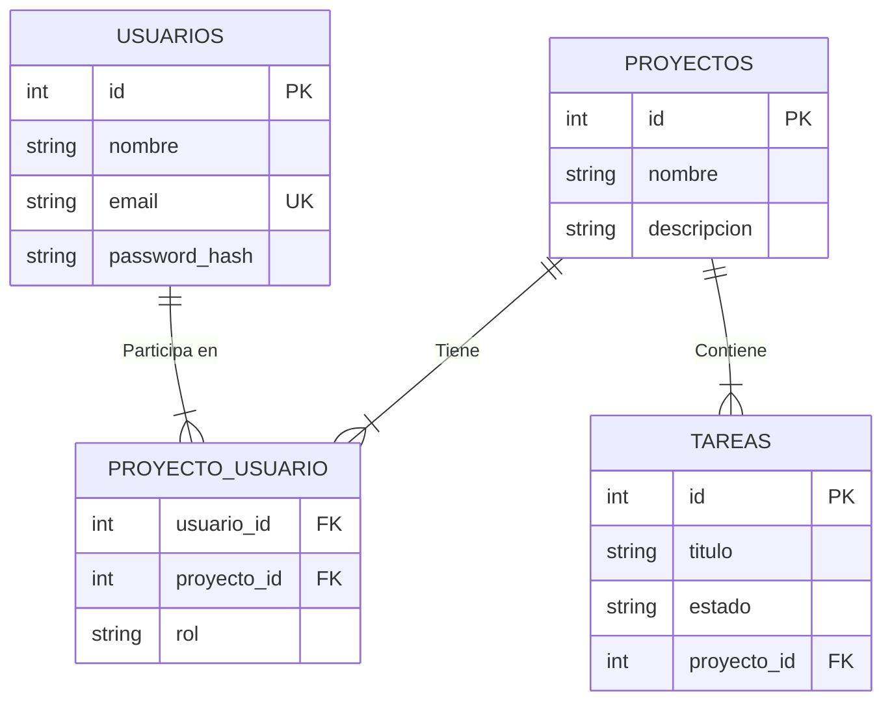
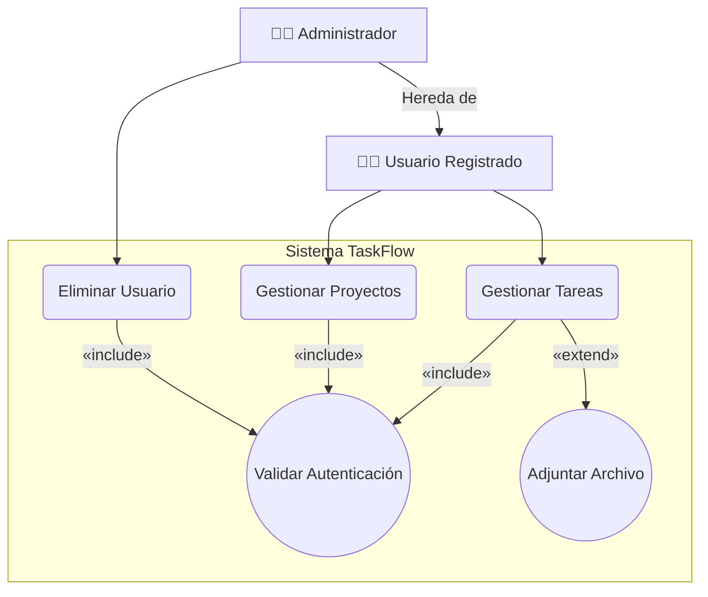
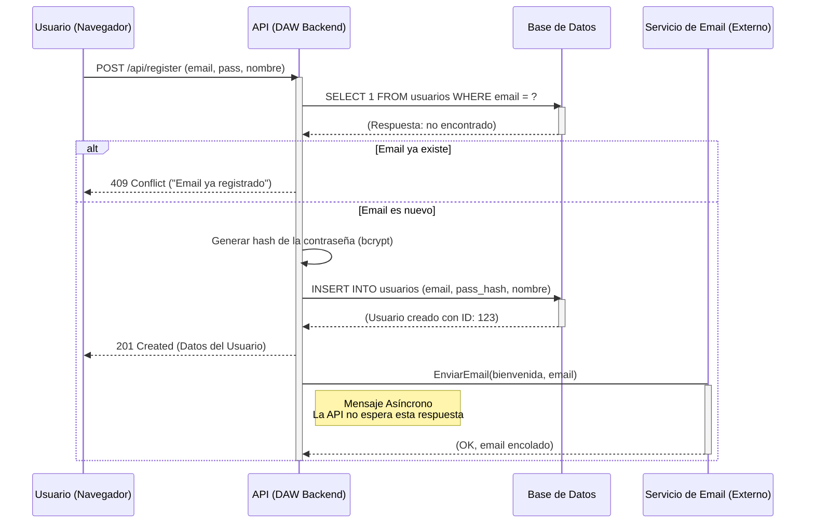
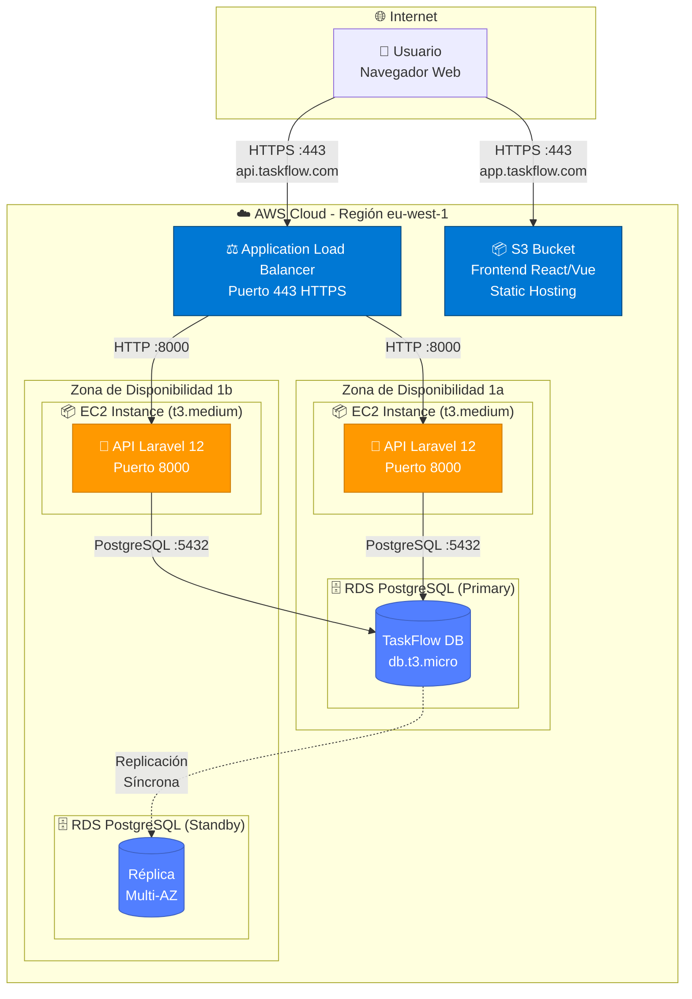
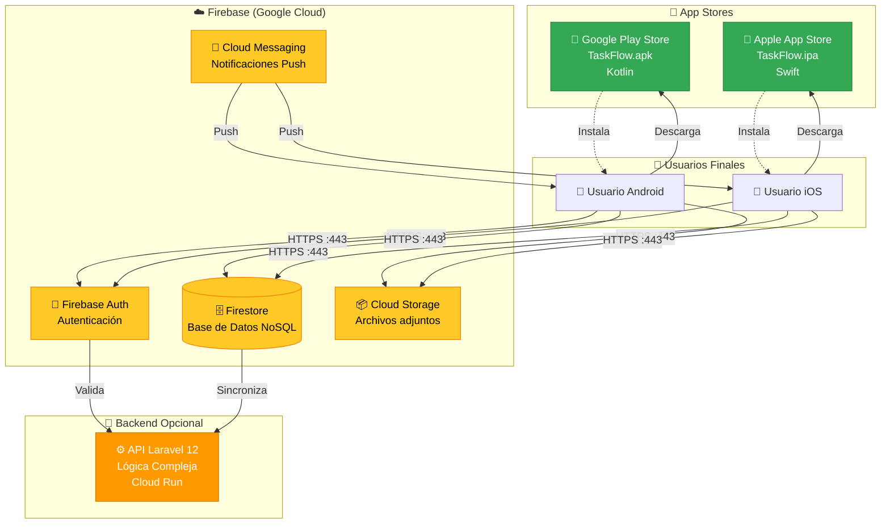
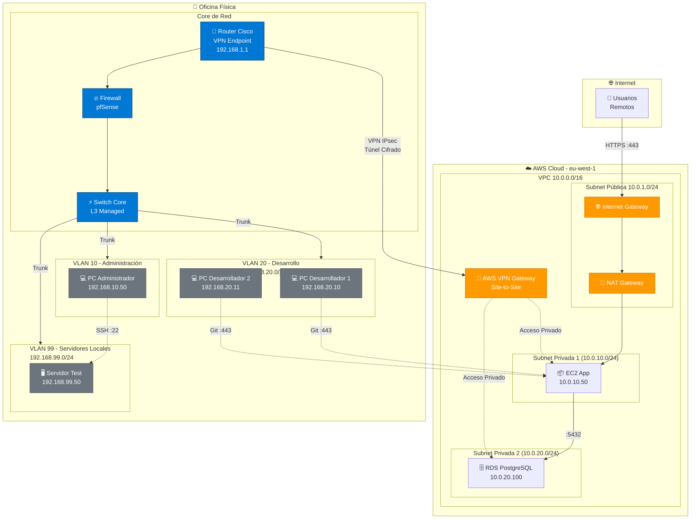

# 7. Diagramas como código

## La Revolución de la Documentación Viva

En el dapítulo anterior vimos herramientas visuales donde "dibujamos" diagramas arrastrando cajas. Son excelentes para exploración, pero tienen un problema fundamental: **se desactualizan**.

Imagina este escenario real:

1. Día 1: Creas un hermoso Diagrama de Contenedores en Draw.io. Lo exportas como `arquitectura.png` y lo subes a Google Drive.
2. Semana 3: El equipo decide añadir un servicio de caché (Redis) a la arquitectura. Se implementa el cambio en el código.
3. Semana 5: Un nuevo desarrollador se une al equipo, ve el diagrama en Google Drive, y piensa que es la arquitectura actual. **Pero no lo es**. Redis no está en el diagrama.

Este es el problema de los **diagramas desconectados del código**. La solución es tratarlos como código.

### ¿Qué Son los "Diagramas como Código" (DaC)?

En lugar de "dibujar" un diagrama con el ratón, lo **describes** escribiendo texto en un lenguaje específico. La herramienta luego genera el diagrama visual automáticamente a partir de ese texto.

## Mermaid

**¿Qué es?**

Mermaid es una sintaxis (un lenguaje simple) que perm ite crear diagramas técnicos escribiendo texto. Es el estándar *de facto* para diagramas como código en 2025.

**¿Por qué es fundamental?** (La filosofía "DaC")

### 1. Se Versiona con tu Código

Este es el beneficio clave. Puedes escribir tu diagrama Mermaid en un archivo `.md` (Markdown) y guardarlo en **Git** junto al código de tu proyecto.

**Flujo de trabajo ideal:**

```bash
# Estructura del repositorio
taskflow/
├── src/
│   ├── controllers/
│   ├── models/
│   └── ...
├── docs/
│   ├── arquitectura.md  # <-- Diagrama Mermaid dentro
│   ├── erd.md
│   └── api-flows.md
└── README.md  # <-- También puede incluir diagramas Mermaid
```

Cuando cambias la arquitectura en el código, **actualizas el texto del diagrama en el mismo commit**. Git guarda ambos juntos. El historial de cambios del diagrama está sincronizado con el historial del código.

### 2. Fuente Única de Verdad

El diagrama vive *con* el código, no en una carpeta perdida de Google Drive o en un archivo `.drawio` que nadie encuentra. Si el código está en GitHub, el diagrama está en GitHub. Si el código está en GitLab, el diagrama está en GitLab.

### 3. Se Renderiza en Todas Partes

GitHub, GitLab, VS Code, Notion, Obsidian, y cientos de herramientas modernas **renderizan Mermaid nativamente**. Escribes el texto, y la plataforma lo convierte en diagrama visual automáticamente.

> [!TIP]
> **Ejemplo en GitHub**
>
> Si en tu `README.md` escribes:
>
> ````markdown
> ```mermaid
> graph LR
>     A[Usuario] --> B[API]
>     B --> C[BD]
> ```
> ````
>
> GitHub lo renderizará automáticamente como un diagrama visual cuando visites el repositorio. No necesitas exportar una imagen ni nada.
>
> ```mermaid
> graph LR
>     A[Usuario] --> B[API]
>     B --> C[BD]
> ```

### 4. Consistencia y Eficiencia

No te preocupas por la alineación perfecta de cajas, los colores, o las fuentes. Te centras solo en la **estructura** y la **lógica**, que es lo que importa. Mermaid decide automáticamente el layout.

Una vez que aprendes la sintaxis, es muchísimo más rápido escribir 5 líneas de texto que arrastrar 15 cajas y alinearlas manualmente.

-----

## Sintaxis de Mermaid para los Diagramas de TaskFlow

Ahora veamos cómo crear los tres tipos de diagramas más comunes (ERD, Casos de Uso, Secuencia) usando la sintaxis de Mermaid. No te preocupes si al principio te parece críptica; con la práctica se vuelve muy intuitiva.

### 1. Creando Diagramas Entidad-Relación (ERD)

Usas el bloque `erDiagram`. La sintaxis es declarativa: describes las entidades, sus atributos y las relaciones entre ellas.

**Sintaxis básica:**

- **Entidad y Atributos:** `ENTIDAD { tipo_dato nombre_atributo [PK, FK, UK] }`
- **Relaciones:** `ENTIDAD1 [cardinalidad1]--[cardinalidad2] ENTIDAD2 : "label"`

**Símbolos de Cardinalidad:**

- `|o` = Cero o uno
- `||` = Exactamente uno
- `}o` = Cero o muchos
- `}{` = Uno o muchos

**Ejemplo: ERD de TaskFlow:**

:::: tabs
== Código Mermaid

```markdown
erDiagram
    USUARIOS ||--|{ PROYECTO_USUARIO : "Participa en"
    PROYECTOS ||--|{ PROYECTO_USUARIO : "Tiene"
    PROYECTOS ||--|{ TAREAS : "Contiene"

    USUARIOS {
        int id PK
        string nombre
        string email UK
        string password_hash
    }
    PROYECTOS {
        int id PK
        string nombre
        string descripcion
    }
    TAREAS {
        int id PK
        string titulo
        string estado
        int proyecto_id FK
    }
    PROYECTO_USUARIO {
        int usuario_id FK
        int proyecto_id FK
        string rol
    }
```

== Visualización Renderizada



::::

### 2. Creando Diagramas de Casos de Uso

Para Casos de Uso, usas el bloque `graph` (un diagrama de flujo estilizado).

**Sintaxis básica:**

- **Actor:** Se representa como un nodo rectangular con emoji o texto.
- **Caso de Uso:** Se representa como un nodo con paréntesis `(Nombre del Caso)`.
- **Relaciones:**
  - `Actor --> CasoDeUso` (Asociación básica)
  - `CasoBase -- "«include»" --> CasoIncluido` (Inclusión)
  - `CasoExtendido -- "«extend»" --> CasoBase` (Extensión)
  - `Hijo -- Hereda de --> Padre` (Generalización)

**Ejemplo: Casos de Uso de TaskFlow:**

:::: tabs
== Código Mermaid

```markdown
flowchart TD
    %% Define Actores
    A[👨‍💻 Usuario Registrado]
    B[👩‍💼 Administrador]
    
    %% Define la frontera del sistema
    subgraph "Sistema TaskFlow"
        C(Gestionar Tareas)
        D(Gestionar Proyectos)
        E((Validar Autenticación))
        F((Adjuntar Archivo))
        G(Eliminar Usuario)
    end

    %% Define Relaciones
    A --> C
    A --> D
    
    %% Include
    C -- "«include»" --> E
    D -- "«include»" --> E
    
    %% Extend
    C -- "«extend»" --> F
    
    %% Generalización (Herencia)
    B -- Hereda de --> A
    B --> G
    G -- "«include»" --> E
```

== Visualización Renderizada



::::

### 3. Creando Diagramas de Secuencia

Usas el bloque `sequenceDiagram`. La sintaxis sigue el flujo cronológico de la conversación entre componentes.

**Sintaxis básica:**

- **Participantes:** "participant ALIAS as Nombre Completo"
- **Mensaje Síncrono:** "A->>B: Texto del mensaje" (flecha sólida con punta)
- **Respuesta:** "B-->>A: Texto de la respuesta" (flecha discontinua)
- **Mensaje Asíncrono:** "A->B: Texto del mensaje" (flecha simple)
- **Bloques de Activación:** "activate" y "deactivate"
- **Fragmentos:** "alt", "else", "loop", "end"

**Ejemplo: Diagrama de Secuencia de Registro en TaskFlow:**

:::: tabs
== Código Mermaid

```markdown
sequenceDiagram
    participant U as Usuario (Navegador)
    participant A as API (DAW Backend)
    participant B as Base de Datos
    participant S as Servicio de Email (Externo)

    U->>A: POST /api/register (email, pass, nombre)
    activate A

    A->>B: SELECT 1 FROM usuarios WHERE email = ?
    activate B
    B-->>A: (Respuesta: no encontrado)
    deactivate B

    alt Email ya existe
        A-->>U: 409 Conflict ("Email ya registrado")
    else Email es nuevo
        A->>A: Generar hash de la contraseña (bcrypt)
        A->>B: INSERT INTO usuarios (email, pass_hash, nombre)
        activate B
        B-->>A: (Usuario creado con ID: 123)
        deactivate B
        
        A-->>U: 201 Created (Datos del Usuario)
        
        A->S: EnviarEmail(bienvenida, email)
        activate S
        note right of A: Mensaje Asíncrono<br/>La API no espera esta respuesta
        S-->>A: (OK, email encolado)
        deactivate S
    end
    deactivate A
```

== Visualización Renderizada



::::

### 4. Creando Diagramas de Despliegue

Para Diagramas de Despliegue, usas el bloque `flowchart` con subgrafos (`subgraph`) para representar nodos físicos (servidores, contenedores, zonas de disponibilidad, redes), y flechas para mostrar las comunicaciones entre ellos.

**Sintaxis básica:**

- **Nodo Físico (Servidor/Contenedor):** `subgraph "Nombre del Nodo"`
- **Artefacto (Software desplegado):** Nodo rectangular o cilindro dentro del subgraph
- **Comunicación:** Flechas con protocolos/puertos: `A -->|HTTPS :443| B`
- **Estilos:** Puedes usar `classDef` para diferenciar visualmente tipos de nodos

> [!NOTE]
> El Diagrama de Despliegue varía significativamente según tu especialización. DAW se centra en infraestructura cloud para backend/frontend web, DAM en distribución de apps móviles, y ASIR en arquitectura de redes completa.

::: details 🌐 DAW - Despliegue Backend + Frontend Web en AWS

Como **DAW**, tu enfoque es desplegar la **API Laravel (backend)** y el **Frontend Web (React/Vue)** en la nube con alta disponibilidad.

:::: tabs
== Código Mermaid

```markdown
flowchart TB
    %% Definir estilos
    classDef azureStyle fill:#0078D4,stroke:#004578,color:#fff
    classDef serverStyle fill:#FF9900,stroke:#CC7A00,color:#fff
    classDef dbStyle fill:#527FFF,stroke:#3D5FBF,color:#fff

    subgraph Internet["🌐 Internet"]
        User[👤 Usuario<br/>Navegador Web]
    end

    subgraph AWS["☁️ AWS Cloud - Región eu-west-1"]
        subgraph AZ1["Zona de Disponibilidad 1a"]
            subgraph EC2_1["📦 EC2 Instance (t3.medium)"]
                API1[🚀 API Laravel 12<br/>Puerto 8000]
            end
            subgraph RDS_Primary["🗄️ RDS PostgreSQL (Primary)"]
                DB1[(TaskFlow DB<br/>db.t3.micro)]
            end
        end

        subgraph AZ2["Zona de Disponibilidad 1b"]
            subgraph EC2_2["📦 EC2 Instance (t3.medium)"]
                API2[🚀 API Laravel 12<br/>Puerto 8000]
            end
            subgraph RDS_Standby["🗄️ RDS PostgreSQL (Standby)"]
                DB2[(Réplica<br/>Multi-AZ)]
            end
        end

        ALB[⚖️ Application Load Balancer<br/>Puerto 443 HTTPS]
        S3[📦 S3 Bucket<br/>Frontend React/Vue<br/>Static Hosting]
    end

    %% Relaciones
    User -->|HTTPS :443<br/>app.taskflow.com| S3
    User -->|HTTPS :443<br/>api.taskflow.com| ALB
    ALB -->|HTTP :8000| API1
    ALB -->|HTTP :8000| API2
    API1 -->|PostgreSQL :5432| DB1
    API2 -->|PostgreSQL :5432| DB1
    DB1 -.->|Replicación<br/>Síncrona| DB2

    %% Aplicar estilos
    class ALB,S3 azureStyle
    class API1,API2 serverStyle
    class DB1,DB2 dbStyle
```

== Visualización Renderizada



> [!TIP]
> **Elementos Clave para DAW**
>
> - **S3 Static Hosting:** Frontend React/Vue como archivos estáticos (HTML/CSS/JS)
> - **Multi-AZ:** Alta disponibilidad con 2 zonas de disponibilidad
> - **ALB:** Distribuye tráfico entre las dos instancias EC2 con la API Laravel
> - **RDS Multi-AZ:** Réplica síncrona automática de PostgreSQL para tolerancia a fallos

::::

::: details 📱 DAM - Despliegue Apps Móviles Nativas

Como **DAM**, tu enfoque es desplegar apps **nativas (Kotlin/Swift)** a través de las **tiendas oficiales** y servicios cloud para backend ligero.

:::: tabs
== Código Mermaid

```markdown
flowchart TB
    %% Definir estilos
    classDef storeStyle fill:#34A853,stroke:#1E7E34,color:#fff
    classDef firebaseStyle fill:#FFCA28,stroke:#F57C00,color:#000
    classDef serverStyle fill:#FF9900,stroke:#CC7A00,color:#fff

    subgraph Stores["📱 App Stores"]
        PlayStore[🤖 Google Play Store<br/>TaskFlow.apk<br/>Kotlin]
        AppStore[🍎 Apple App Store<br/>TaskFlow.ipa<br/>Swift]
    end

    subgraph Users["👥 Usuarios Finales"]
        AndroidUser[📱 Usuario Android]
        iOSUser[📱 Usuario iOS]
    end

    subgraph Firebase["☁️ Firebase (Google Cloud)"]
        FCM[🔔 Cloud Messaging<br/>Notificaciones Push]
        Firestore[(🗄️ Firestore<br/>Base de Datos NoSQL)]
        Auth[🔐 Firebase Auth<br/>Autenticación]
        Storage[📦 Cloud Storage<br/>Archivos adjuntos]
    end

    subgraph Backend["🚀 Backend Opcional"]
        API[⚙️ API Laravel 12<br/>Lógica Compleja<br/>Cloud Run]
    end

    %% Relaciones
    AndroidUser -->|Descarga| PlayStore
    iOSUser -->|Descarga| AppStore
    PlayStore -.->|Instala| AndroidUser
    AppStore -.->|Instala| iOSUser

    AndroidUser -->|HTTPS :443| Auth
    iOSUser -->|HTTPS :443| Auth
    AndroidUser -->|HTTPS :443| Firestore
    iOSUser -->|HTTPS :443| Firestore
    AndroidUser -->|HTTPS :443| Storage
    iOSUser -->|HTTPS :443| Storage

    FCM -->|Push| AndroidUser
    FCM -->|Push| iOSUser

    Auth -->|Valida| API
    Firestore -->|Sincroniza| API

    %% Aplicar estilos
    class PlayStore,AppStore storeStyle
    class FCM,Firestore,Auth,Storage firebaseStyle
    class API serverStyle
```

== Visualización Renderizada



> [!TIP]
> **Elementos Clave para DAM**
>
> - **App Stores:** Distribución oficial (Google Play + Apple App Store)
> - **Firebase:** BaaS (Backend as a Service) que simplifica autenticación, base de datos y notificaciones
> - **Cloud Messaging (FCM):** Notificaciones push a Android/iOS
> - **Backend Opcional:** Para lógica compleja que no puede estar en Firebase

::::

::: details 🔧 ASIR - Arquitectura de Red Completa (Cloud + Física)

Como **ASIR**, tu enfoque es diseñar la **infraestructura de red completa**: cloud (AWS), red física (oficina), VLANs, subnetting y conectividad VPN site-to-site.

:::: tabs
== Código Mermaid

```markdown
flowchart TB
    %% Definir estilos
    classDef awsStyle fill:#FF9900,stroke:#CC7A00,color:#fff
    classDef networkStyle fill:#0078D4,stroke:#004578,color:#fff
    classDef physicalStyle fill:#6C757D,stroke:#495057,color:#fff

    subgraph Internet["🌐 Internet"]
        Users[👥 Usuarios<br/>Remotos]
    end

    subgraph AWS["☁️ AWS Cloud - eu-west-1"]
        subgraph VPC["VPC 10.0.0.0/16"]
            subgraph PublicSubnet["Subnet Pública 10.0.1.0/24"]
                IGW[🌐 Internet Gateway]
                NAT[🔀 NAT Gateway]
            end

            subgraph PrivateSubnet1["Subnet Privada 1 (10.0.10.0/24)"]
                EC2_1[📦 EC2 App<br/>10.0.10.50]
            end

            subgraph PrivateSubnet2["Subnet Privada 2 (10.0.20.0/24)"]
                RDS[🗄️ RDS PostgreSQL<br/>10.0.20.100]
            end

            VPN_AWS[🔐 AWS VPN Gateway<br/>Site-to-Site]
        end
    end

    subgraph Oficina["🏢 Oficina Física"]
        subgraph Core["Core de Red"]
            Router[🔀 Router Cisco<br/>VPN Endpoint<br/>192.168.1.1]
            Firewall[🔥 Firewall<br/>pfSense]
            Switch_Core[⚡ Switch Core<br/>L3 Managed]
        end

        subgraph VLAN10["VLAN 10 - Administración<br/>192.168.10.0/24"]
            PC_Admin[💻 PC Administrador<br/>192.168.10.50]
        end

        subgraph VLAN20["VLAN 20 - Desarrollo<br/>192.168.20.0/24"]
            PC_Dev1[💻 PC Desarrollador 1<br/>192.168.20.10]
            PC_Dev2[💻 PC Desarrollador 2<br/>192.168.20.11]
        end

        subgraph VLAN99["VLAN 99 - Servidores Locales<br/>192.168.99.0/24"]
            Server_Local[🖥️ Servidor Test<br/>192.168.99.50]
        end
    end

    %% Relaciones
    Users -->|HTTPS :443| IGW
    IGW --> NAT
    NAT --> EC2_1
    EC2_1 -->|:5432| RDS

    Router -->|VPN IPsec<br/>Túnel Cifrado| VPN_AWS
    VPN_AWS -.->|Acceso Privado| EC2_1
    VPN_AWS -.->|Acceso Privado| RDS

    Router --> Firewall
    Firewall --> Switch_Core
    Switch_Core -->|Trunk| VLAN10
    Switch_Core -->|Trunk| VLAN20
    Switch_Core -->|Trunk| VLAN99

    PC_Admin -.->|SSH :22| Server_Local
    PC_Dev1 -.->|Git :443| EC2_1
    PC_Dev2 -.->|Git :443| EC2_1

    %% Aplicar estilos
    class IGW,NAT,VPN_AWS awsStyle
    class Router,Firewall,Switch_Core networkStyle
    class PC_Admin,PC_Dev1,PC_Dev2,Server_Local physicalStyle
```

== Visualización Renderizada



> [!TIP]
> **Elementos Clave para ASIR**
>
> - **VPC + Subnets:** Segmentación lógica en AWS (pública/privadas con diferentes rangos IP)
> - **VPN Site-to-Site:** Conecta la oficina física con AWS mediante túnel IPsec cifrado
> - **VLANs:** Segmentación física en la oficina (Administración, Desarrollo, Servidores)
> - **Routing:** Switch L3 + Router + Firewall para control de tráfico entre segmentos
> - **Direccionamiento IP:** Plan completo de subnetting (AWS: 10.0.0.0/16, Oficina: 192.168.0.0/16)

::::

-----

## Recursos para Aprender Mermaid

Si quieres dominar Mermaid (y te recomiendo que lo hagas), aquí están los mejores recursos:

1. **Mermaid Live Editor:** <https://mermaid.live/>
   - Editor en línea donde puedes practicar sintaxis en tiempo real y ver el resultado inmediatamente.

2. **Documentación Oficial:** <https://mermaid.js.org/>
   - Tiene ejemplos para cada tipo de diagrama (ERD, Sequence, Flowchart, Gantt, etc.).

3. **Extensión de VS Code:** "Mermaid Preview"
   - Previsualiza tus diagramas Mermaid directamente en VS Code mientras escribes.
