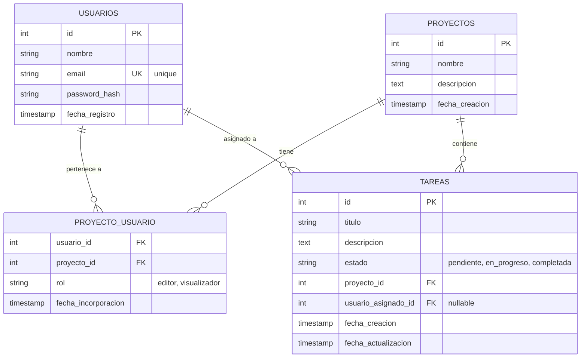
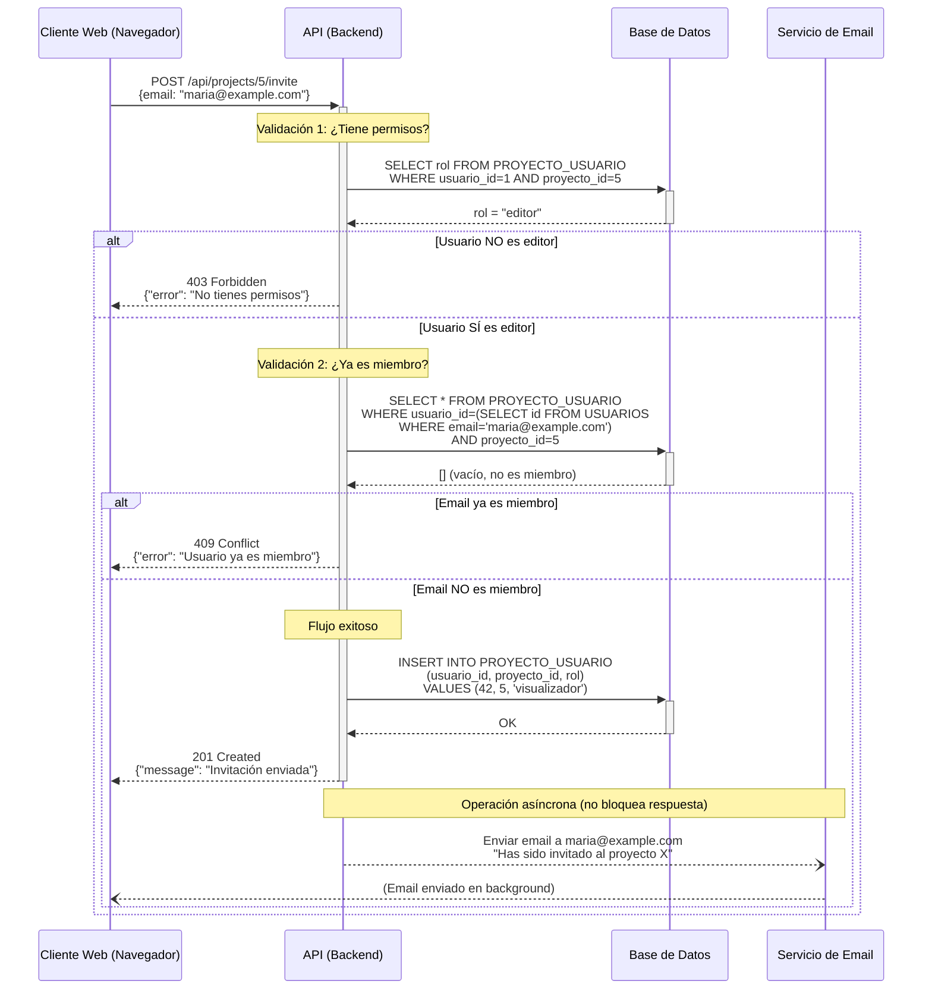
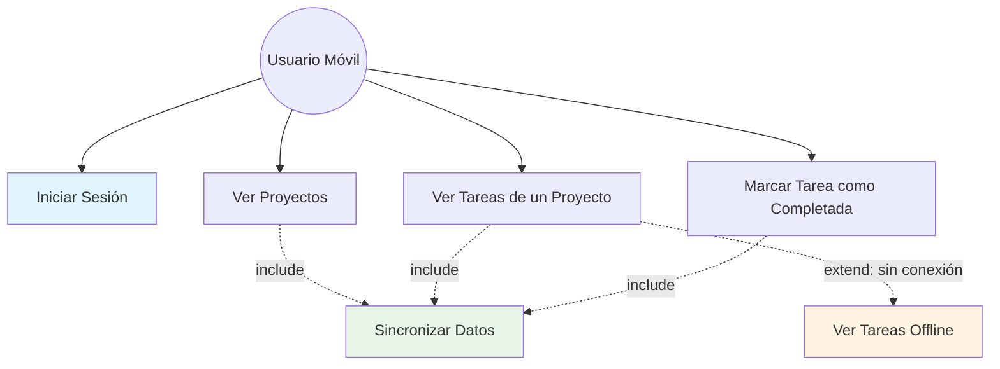
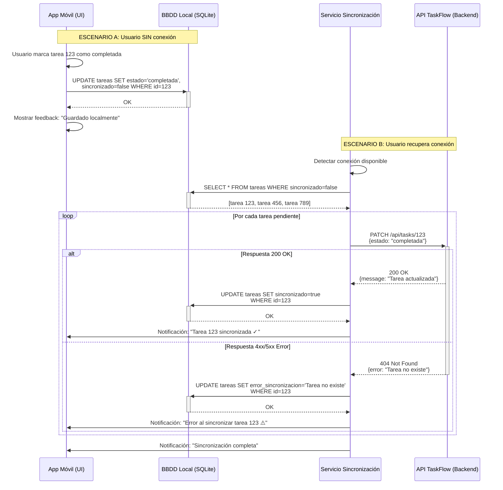
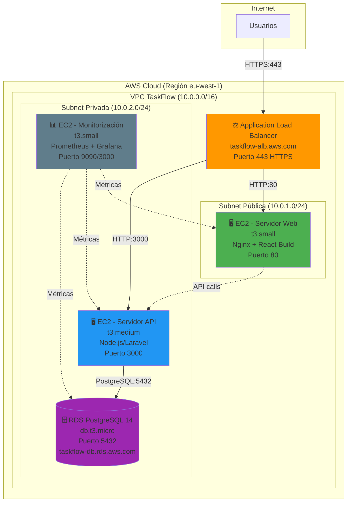
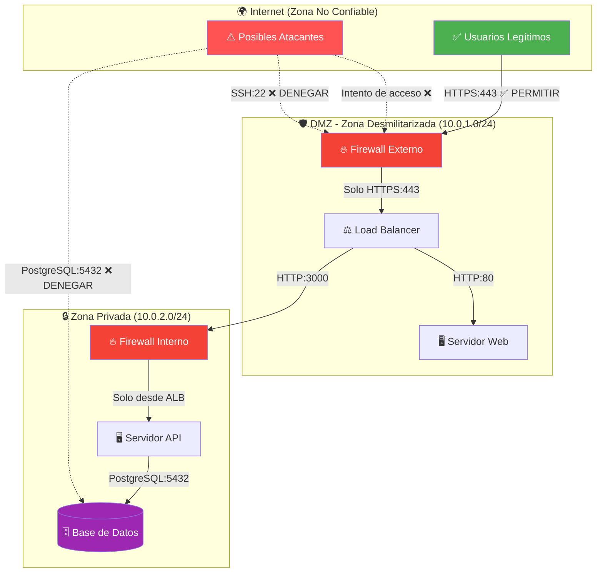

# 8. Aplicación Práctica: Diseñando TaskFlow

Hemos recorrido un largo camino. En los capítulos 1-8, habéis aprendido:

- **Qué es la arquitectura de software** y por qué es crítica (Cap. 1).
- **Cómo diseñar la vista externa del sistema** con Diagramas de Contexto, Contenedores y Despliegue (Cap. 2).
- **Cómo modelar los datos** con Diagramas Entidad-Relación (Cap. 3).
- **Cómo definir el comportamiento funcional** con Diagramas de Casos de Uso (Cap. 4).
- **Cómo diseñar el flujo técnico de implementación** con Diagramas de Secuencia (Cap. 5).
- **Qué herramientas usar** para crear estos diagramas (Cap. 6-7).

Ahora llega el momento de la verdad: **aplicar todo esto al proyecto real de TaskFlow**.

En esta fase, ya sois los **arquitectos de software** de vuestros respectivos equipos (DAW, DAM, ASIR). Vuestros diagramas son las **herramientas de coordinación** que permitirán que tres equipos diferentes construyan un único sistema coherente.

:::: tabs

== 📘 Equipo DAW (Web + API)

**Misión:** Diseñar la **estructura de datos** (el corazón) y la **lógica de la API** (el cerebro).

::: details Tarea 1: Ampliar el Diagrama Entidad-Relación (ERD) - (Capítulo 3)

**Contexto:** En el **Capítulo 3** viste un ERD básico de TaskFlow con 4 entidades (`USUARIOS`, `PROYECTOS`, `TAREAS`, `PROYECTO_USUARIO`). Ahora debes **ampliarlo** para soportar nuevas funcionalidades.

**Objetivo:** Ampliar el ERD existente añadiendo las siguientes funcionalidades:

**Herramienta recomendada:**

- **Opción 1 (Rápida):** Mermaid (`erDiagram`) en un archivo `docs/database-completo.md` del repositorio.
- **Opción 2 (Visual):** Draw.io si necesitáis más control visual.

**Nuevas entidades a añadir:**

1. **`COMENTARIOS`** (para que los usuarios puedan comentar en las tareas):
   - Atributos: `id`, `contenido`, `tarea_id`, `usuario_id`, `fecha_creacion`
   - Relación: **1:N** con `TAREAS` (una tarea puede tener muchos comentarios)
   - Relación: **1:N** con `USUARIOS` (un usuario puede escribir muchos comentarios)

2. **`ETIQUETAS`** (para clasificar tareas: "urgente", "bug", "mejora"):
   - Atributos: `id`, `nombre`, `color`
   - Relación: **N:M** con `TAREAS` a través de tabla pivote `TAREA_ETIQUETA`

3. **`ARCHIVOS_ADJUNTOS`** (para subir documentos a las tareas):
   - Atributos: `id`, `nombre_archivo`, `url_storage`, `tarea_id`, `usuario_subida_id`, `fecha_subida`
   - Relación: **1:N** con `TAREAS` (una tarea puede tener múltiples archivos)
   - Relación: **1:N** con `USUARIOS` (rastreamos quién subió cada archivo)

4. **Tabla pivote `TAREA_ETIQUETA`**:
   - Atributos: `tarea_id`, `etiqueta_id`

**Modificaciones a entidades existentes:**

- Añadir a `TAREAS`:
  - `fecha_limite` (timestamp nullable): Para deadlines
  - `prioridad` (enum: "baja", "media", "alta"): Para ordenar por importancia
  - `usuario_creador_id` (FK): Quién creó la tarea originalmente (diferente de quién la tiene asignada)

- Añadir a `USUARIOS`:
  - `avatar_url` (string nullable): URL de la foto de perfil
  - `ultimo_acceso` (timestamp): Para saber si están activos

**Preguntas que tu ERD ampliado debe responder:**

1. ¿Cómo obtengo todos los comentarios de una tarea específica ordenados por fecha?
2. ¿Cómo busco todas las tareas con la etiqueta "urgente" en un proyecto?
3. ¿Cómo listo todos los archivos adjuntos subidos por un usuario específico?
4. ¿Cómo diferencio entre el usuario que creó una tarea y el usuario que la tiene asignada actualmente?
5. ¿Cómo obtengo las tareas que expiran en los próximos 7 días?

:::
::: details Solución: ERD de TaskFlow



**Explicación de decisiones de diseño:**

- **Tabla pivote `PROYECTO_USUARIO`:** Resuelve la relación N:M entre usuarios y proyectos. El campo `rol` permite control de permisos.
- **`usuario_asignado_id` nullable en `TAREAS`:** Una tarea puede existir sin estar asignada a nadie todavía.
- **Estado de tarea como enum:** Limita los valores válidos a `pendiente`, `en_progreso`, `completada`.
- **Claves foráneas (FK):** Garantizan integridad referencial (no puedo asignar una tarea a un proyecto inexistente).

**Consultas SQL que este ERD permite:**

```sql
-- ¿Qué tareas tiene un proyecto específico?
SELECT * FROM TAREAS WHERE proyecto_id = 1;

-- ¿Qué usuarios tienen acceso al proyecto 5?
SELECT u.* FROM USUARIOS u
INNER JOIN PROYECTO_USUARIO mp ON u.id = mp.usuario_id
WHERE mp.proyecto_id = 5;

-- ¿Qué tareas están asignadas al usuario "juan@example.com"?
SELECT t.* FROM TAREAS t
INNER JOIN USUARIOS u ON t.usuario_asignado_id = u.id
WHERE u.email = 'juan@example.com';
```

:::

::: details Tarea 2: Crear un Nuevo Diagrama de Secuencia - Añadir Comentario con Notificación (Capítulo 5)

**Contexto:** En el **Capítulo 5** viste un diagrama de secuencia para "Registro de usuario" y en **Capítulo 7** viste el ejemplo de "Invitación a proyecto". Ahora debes **crear uno nuevo** para una funcionalidad diferente.

**Objetivo:** Modelar el flujo técnico completo de: **"Usuario añade un comentario a una tarea y se notifica al usuario asignado"**.

**Herramienta recomendada:**

- **Opción 1:** Mermaid (`sequenceDiagram`) en `docs/diagramas/secuencia-comentarios.md`
- **Opción 2:** Lucidchart o Draw.io

**Participantes (Líneas de Vida) a incluir:**

- `Cliente Web (Navegador)`: Usuario que escribe el comentario
- `API (Backend Laravel)`: Procesa la petición
- `Base de Datos (PostgreSQL)`: Valida y almacena datos
- `Servicio Notificaciones`: Envía notificación push/email (asíncrono)
- `Servicio Websocket (opcional)`: Actualiza la UI en tiempo real

**Lógica a modelar (usad fragmentos `alt` y `loop`):**

1. **Validación de autenticación:**
   - ¿El usuario está autenticado? Si no → 401 Unauthorized

2. **Validación de permisos:**
   - ¿El usuario tiene acceso al proyecto de la tarea? (consultar `PROYECTO_USUARIO`)
   - Si no → 403 Forbidden

3. **Validación de existencia:**
   - ¿La tarea existe? Si no → 404 Not Found

4. **Inserción del comentario:**
   - `INSERT INTO COMENTARIOS` con los datos del comentario
   - Obtener el `usuario_asignado_id` de la tarea

5. **Notificación asíncrona** (solo si la tarea tiene usuario asignado):
   - Si `usuario_asignado_id` NO es NULL:
     - Enviar notificación push al usuario asignado
     - Enviar email (opcional, según preferencias del usuario)
     - Actualizar contador de notificaciones en tiempo real (Websocket)

**Casos especiales a considerar:**

- **Caso A:** Tarea sin usuario asignado → No enviar notificación
- **Caso B:** El comentador ES el usuario asignado → No autonotificarse
- **Caso C:** Usuario asignado tiene notificaciones deshabilitadas → Solo registrar, no enviar

> [!IMPORTANT]
> **Elementos obligatorios en tu diagrama:**
>
> - ✅ Usar `activate` y `deactivate` para mostrar tiempos de procesamiento
> - ✅ Usar `->>` para mensajes síncronos y `--)` para asíncronos
> - ✅ Usar `alt` para las validaciones condicionales
> - ✅ Usar `note` para explicar decisiones técnicas importantes
> - ✅ Mostrar códigos HTTP correctos (200, 201, 401, 403, 404, 500)
>
> **Bonus:** Implementar el controlador Laravel correspondiente basándose en tu diagrama

:::
::: details 💡 Solución: Diagrama de Secuencia - Invitación a Proyecto



**Explicación de decisiones técnicas:**

- **Validación de permisos ANTES de cualquier operación:** Si el usuario no es "editor", rechazamos inmediatamente con 403.
- **Validación de duplicados:** Evitamos errores de integridad al verificar si el email ya está en `PROYECTO_USUARIO`.
- **Respuesta asíncrona del email:** El API responde 201 Created sin esperar al envío del email. El cliente no debe bloquearse esperando un servicio externo (SMTP).
- **Códigos HTTP específicos:** 403 (sin permisos), 409 (conflicto), 201 (creado correctamente).

:::

== Equipo DAM (Multiplataforma)

**Misión:** Diseñar la **experiencia del usuario móvil** y gestionar el **modo offline** (el desafío más técnico).

::: details Tarea 1: Ampliar el Diagrama de Casos de Uso con Funcionalidades Avanzadas (Capítulo 4)

**Contexto:** En el **Capítulo 4** viste un diagrama de casos de uso básico para la app móvil con funcionalidades esenciales (Ver Tareas, Marcar Completada, Modo Offline). En el **Capítulo 7** viste la versión con sintaxis Mermaid. Ahora debes **ampliarlo** con funcionalidades avanzadas.

**Objetivo:** Ampliar el diagrama de casos de uso existente añadiendo:

**Herramienta recomendada:**

- **Opción 1 (Rápida):** Mermaid (`flowchart TD`) en `docs/diagramas/casos-uso-movil-completo.md`
- **Opción 2 (Profesional):** Lucidchart para mayor claridad visual

**Actores a incluir:**

- `Usuario Móvil` (actor principal - ya existe)
- `Usuario Premium` (hereda de Usuario Móvil) - **NUEVO**
- `Sistema de Notificaciones` (actor secundario - sistema externo) - **NUEVO**

**Nuevos casos de uso a añadir:**

1. **Gestionar Comentarios:**
   - Subcasos: `Añadir Comentario`, `Ver Comentarios`, `Editar Comentario Propio`
   - Relación: `<<include>>` "Validar Permisos de Proyecto"

2. **Adjuntar Archivos a Tarea:**
   - Actor: Solo `Usuario Premium`
   - Relación: `<<extend>>` desde "Añadir Comentario" (opcional adjuntar archivo en comentario)
   - Relación: `<<include>>` "Subir a Cloud Storage"

3. **Recibir Notificaciones Push:**
   - Actor: `Sistema de Notificaciones` → `Usuario Móvil`
   - Casos específicos: "Notificación de nuevo comentario", "Notificación de tarea asignada"

4. **Filtrar Tareas por Etiqueta:**
   - Actor: `Usuario Móvil`
   - Relación: `<<extend>>` desde "Ver Tareas de un Proyecto" (filtrado opcional)

5. **Configurar Preferencias Offline:**
   - Actor: `Usuario Móvil`
   - Permite elegir: ¿Qué proyectos sincronizar offline? ¿Solo WiFi o también datos móviles?

**Relaciones clave a identificar:**

- **`<<include>>`:** ¿Qué casos de uso SIEMPRE ejecutan otros?
  - Ejemplo: "Añadir Comentario" siempre incluye "Validar Permisos de Proyecto"
  
- **`<<extend>>`:** ¿Qué casos de uso son OPCIONALES en otros?
  - Ejemplo: "Adjuntar Archivo" extiende "Añadir Comentario" (puedes comentar sin adjuntar)

- **Herencia de actores:** `Usuario Premium` hereda todos los casos de uso de `Usuario Móvil` + casos exclusivos

**Preguntas que tu diagrama debe responder:**

1. ¿Qué diferencias funcionales hay entre Usuario Móvil y Usuario Premium?
2. ¿Qué casos de uso requieren conexión obligatoria vs. funcionan offline?
3. ¿Cómo se relaciona "Recibir Notificaciones Push" con "Añadir Comentario"?
4. ¿En qué casos se ejecuta "Sincronizar Datos"? (pista: es `<<include>>` en varios casos)
5. ¿Puede un usuario comentar en una tarea de un proyecto del que no es miembro?

:::
::: details Solución: Diagrama de Casos de Uso - App Móvil



**Explicación de las relaciones:**

- **`<<include>>` en Sincronizar Datos:** Se ejecuta automáticamente cuando hay conexión en casos como "Ver Proyectos", "Ver Tareas" y "Marcar Completada".
- **`<<extend>>` en Ver Tareas (Offline):** Solo se activa cuando NO hay conexión. Es una extensión opcional del caso base "Ver Tareas".
- **Iniciar Sesión:** Caso independiente que NO funciona offline (requiere validación en el servidor).

**Casos de uso con conexión obligatoria:**

- Iniciar Sesión (autenticación remota)
- Sincronizar Datos (necesita comunicación con la API)

**Casos de uso que funcionan offline:**

- Ver Tareas (lee de la base de datos local)
- Marcar Tarea como Completada (guarda localmente, sincroniza después)

:::

::: details Tarea 2: Ampliar el Diagrama de Secuencia - Sincronización con Resolución de Conflictos (Capítulo 5)

**Contexto:** En el **Capítulo 7** viste un diagrama de secuencia básico de sincronización offline (marcar tarea completada → sincronizar). Ahora debes **ampliarlo** para manejar un caso complejo: **resolución de conflictos**.

**Objetivo:** Extender el diagrama de sincronización para incluir el caso: **"Dos usuarios modifican la misma tarea offline simultáneamente"**.

**Herramienta recomendada:**

- **Opción 1:** Mermaid (`sequenceDiagram`) en `docs/diagramas/secuencia-sync-conflictos.md`
- **Opción 2:** Lucidchart o Draw.io

**Participantes (Líneas de Vida):**

- `App Usuario A (UI)`: Primer usuario que modifica offline
- `BBDD Local A (SQLite)`: Base de datos local del Usuario A
- `Servicio Sync A`: Lógica de sincronización del Usuario A
- `API TaskFlow (Backend)`: Servidor remoto (fuente única de verdad)
- `Servicio Sync B`: Lógica de sincronización del Usuario B
- `BBDD Local B (SQLite)`: Base de datos local del Usuario B
- `App Usuario B (UI)`: Segundo usuario que modifica offline

**Escenario de Conflicto a Modelar:**

**Situación inicial:**

- Ambos usuarios tienen la Tarea #123 sincronizada en versión 1: `{id: 123, estado: "pendiente", version: 1}`

**Timeline del conflicto:**

```text
T0: Ambos usuarios pierden conexión
T1: Usuario A cambia estado a "en_progreso" (offline)
T2: Usuario B cambia estado a "completada" (offline)
T3: Usuario A recupera conexión y sincroniza PRIMERO
T4: Usuario B recupera conexión e intenta sincronizar (CONFLICTO)
```

**Lógica a implementar en el diagrama:**

1. **Usuario A sincroniza exitosamente:**
   - Servicio Sync A envía: `PATCH /api/tasks/123 {estado: "en_progreso", version: 1}`
   - API valida versión, actualiza a versión 2, responde 200 OK
   - BBDD Local A se actualiza: `{version: 2, estado: "en_progreso"}`

2. **Usuario B intenta sincronizar (CONFLICTO):**
   - Servicio Sync B envía: `PATCH /api/tasks/123 {estado: "completada", version: 1}`
   - API detecta: "Versión 1 es antigua, versión actual es 2" → 409 Conflict
   - API responde con datos actuales del servidor: `{version: 2, estado: "en_progreso", modificado_por: "Usuario A"}`

3. **Resolución del conflicto:**
   - Servicio Sync B muestra diálogo al Usuario B:
     - "Conflicto detectado: Usuario A cambió la tarea a 'en_progreso'"
     - "Tu cambio local: 'completada'. ¿Qué hacer?"
     - Opciones: [Mantener el del servidor] [Usar mi cambio] [Fusionar cambios]
  
   - **Opción A:** Usuario B elige "Mantener del servidor"
     - BBDD Local B actualiza a versión del servidor
  
   - **Opción B:** Usuario B elige "Usar mi cambio"
     - Servicio Sync B reintenta: `PATCH /api/tasks/123 {estado: "completada", version: 2, force: true}`
     - API actualiza a versión 3 con el cambio de Usuario B

**Elementos técnicos obligatorios:**

- Usar `par` (parallel) para mostrar que ambos usuarios modifican simultáneamente
- Usar `alt` para las diferentes resoluciones del conflicto
- Usar `opt` para mostrar notificación opcional al Usuario A cuando su cambio es sobrescrito
- Incluir timestamps (`ultima_modificacion`) en las respuestas
- Mostrar códigos HTTP: 200 OK, 409 Conflict, 412 Precondition Failed

> [!IMPORTANT]
> **Preguntas que tu diagrama debe responder:**
>
> 1. ¿Cómo detecta el servidor que hay un conflicto de versión?
> 2. ¿Qué información envía el servidor en el 409 Conflict para ayudar a resolver el conflicto?
> 3. ¿Qué pasa si el Usuario B ignora el conflicto y no elige ninguna opción?
> 4. ¿Cómo se notifica al Usuario A si su cambio fue sobrescrito?
> 5. ¿Qué pasa si AMBOS usuarios eligen "Usar mi cambio"? (pista: el último gana)
>
> **Bonus:** Implementar el esquema de versioning en la base de datos y el controlador Laravel que maneja el 409 Conflict

:::
::: details Solución: Diagrama de Secuencia - Sincronización Offline



**Explicación de decisiones técnicas:**

- **Campo `sincronizado` en BBDD Local:** Marca qué registros necesitan enviarse al servidor. Inicialmente `false` cuando se crea/modifica offline.
- **Campo `error_sincronizacion`:** Guarda el mensaje de error si la sincronización falla. Permite al usuario saber qué pasó.
- **Procesamiento por lotes (loop):** El servicio sincroniza todas las tareas pendientes una por una.
- **Manejo de errores individualizado:** Si una tarea falla (404, 409, 500), no bloquea la sincronización de las demás.

**Estrategias avanzadas (opcional):**

- **Reintentos automáticos:** Si falla por timeout, reintentar 3 veces con backoff exponencial.
- **Sincronización inteligente:** Solo sincronizar los campos modificados (PATCH parcial).
- **Resolución de conflictos:** Si el servidor tiene una versión más reciente, preguntar al usuario qué versión mantener.

:::

== Equipo ASIR (Sistemas)

**Misión:** Diseñar el **despliegue en la nube** (¿dónde vivirán las aplicaciones?) y la **arquitectura de seguridad** (¿cómo protegemos el sistema?).

::: details Tarea 1: Ampliar el Diagrama de Despliegue con Entornos Múltiples (Capítulo 2B)

**Contexto:** En el **Capítulo 2B** viste un diagrama de despliegue básico en AWS con un solo entorno. En el **Capítulo 7** viste la sintaxis Mermaid para crearlo. Ahora debes **ampliarlo** con arquitectura de múltiples entornos.

**Objetivo:** Diseñar la arquitectura completa de 3 entornos (Desarrollo, Staging, Producción) en AWS.

**Herramienta recomendada:**

- **Opción 1:** Mermaid (`flowchart TB`) en `docs/diagramas/despliegue-multi-entorno.md`
- **Opción 2:** Draw.io con iconos de AWS

**Arquitectura de 3 Entornos a Diseñar:**

**1. Entorno de DESARROLLO (dev.taskflow.com):**

- 1x EC2 t3.micro (Backend + Frontend en mismo servidor)
- 1x RDS PostgreSQL db.t3.micro (base de datos compartida dev)
- Sin balanceador (acceso directo)
- Sin Multi-AZ (no es crítico)
- Costo: ~30€/mes

**2. Entorno de STAGING (staging.taskflow.com):**

- 2x EC2 t3.small (1 Backend + 1 Frontend)
- 1x ALB (Application Load Balancer)
- 1x RDS PostgreSQL db.t3.small (replica de producción con datos anonimizados)
- Sin Multi-AZ (no es crítico, pero similar a producción)
- Costo: ~60€/mes

**3. Entorno de PRODUCCIÓN (taskflow.com):**

- 3x EC2 t3.medium (2 Backend + 1 Frontend) con Auto Scaling Group
- 1x ALB con certificado SSL/TLS
- 1x RDS PostgreSQL db.t3.medium con Multi-AZ (alta disponibilidad)
- 1x ElastiCache Redis (caché de sesiones)
- 1x S3 Bucket (almacenamiento de archivos adjuntos)
- CloudWatch para logs y alarmas
- Costo: ~180€/mes

**🔧 Elementos adicionales a incluir:**

1. **Pipeline CI/CD:**
   - GitHub Actions → Deploy automático a DEV en cada push a `main`
   - GitHub Actions → Deploy manual a STAGING para pruebas pre-producción
   - GitHub Actions → Deploy manual con aprobación a PRODUCCIÓN

2. **VPC y Subnets:**
   - 1 VPC por entorno (aislamiento completo)
   - Subnets públicas (ALB, NAT Gateway)
   - Subnets privadas (EC2 Backend, RDS)

3. **Security Groups específicos:**
   - SG-ALB: Permite HTTPS (443) desde Internet
   - SG-EC2-Backend: Solo acepta tráfico desde SG-ALB
   - SG-RDS: Solo acepta tráfico desde SG-EC2-Backend
   - SG-Redis: Solo acepta tráfico desde SG-EC2-Backend

4. **Backup y Recuperación:**
   - RDS Automated Backups (7 días en dev, 14 días en staging, 30 días en producción)
   - S3 Versioning habilitado en archivos adjuntos

**Relaciones clave a mostrar:**

- Flujo de deployment: GitHub → Actions → Entorno correspondiente
- Acceso entre entornos: ¿Puede DEV acceder a la BD de PRODUCCIÓN? (NO)
- Promoción de código: DEV → STAGING → PRODUCCIÓN (solo código, no datos)
- Backup/Restore: PRODUCCIÓN → STAGING (datos anonimizados)

**Preguntas que tu diagrama debe responder:**

1. ¿Cómo despliega el equipo DAW un cambio que debe probarse antes de llegar a producción?
2. ¿Qué diferencias de configuración hay entre DEV y PRODUCCIÓN?
3. ¿Puede un desarrollador conectarse directamente a la base de datos de producción?
4. ¿Dónde se almacenan los archivos adjuntos en cada entorno?
5. ¿Qué pasa si se cae una instancia EC2 en producción?

:::
::: details Solución: Diagrama de Despliegue en AWS



**Explicación de la arquitectura:**

- **Application Load Balancer (ALB):** Punto de entrada único. Distribuye tráfico entre Frontend (puerto 80) y Backend (puerto 3000) según las rutas URL.
- **Subnet Pública:** Contiene el Servidor Web (Frontend). Tiene acceso directo a Internet a través de un Internet Gateway.
- **Subnet Privada:** Contiene API y Base de Datos. NO es accesible directamente desde Internet (solo a través del ALB).
- **RDS PostgreSQL:** Base de datos gestionada por AWS. Solo acepta conexiones desde la Subnet Privada.
- **Monitoring:** Prometheus recoge métricas de todos los componentes. Grafana visualiza dashboards.

**Configuración de rutas en el ALB:**

```yaml
# Reglas del Application Load Balancer
Regla 1:
  Condición: Path = /api/*
  Acción: Forward a APIServer:3000

Regla 2:
  Condición: Path = /* (default)
  Acción: Forward a WebServer:80
```

:::

::: details Tarea 2: Crear un Diagrama de Red Híbrida (Cloud + Oficina On-Premise) - Capítulo 2B

**Contexto:** En el **Capítulo 2B** viste un diagrama de red en AWS. En el **Capítulo 7** viste un ejemplo de red física con VLANs. Ahora debes **crear un diagrama completo** que integre ambos mundos: **Cloud + Red Física de Oficina**.

**Objetivo:** Diseñar la arquitectura de red híbrida de TaskFlow: AWS Cloud + Oficina física de la empresa conectadas mediante VPN Site-to-Site.

**Herramienta recomendada:**

- **Opción 1:** Mermaid (`flowchart TB`) en `docs/diagramas/red-hibrida.md`
- **Opción 2:** Draw.io con iconos de red (routers, switches, VPN, firewalls)

### Parte 1: Red Cloud en AWS (ya conocida)

- **VPC:** 10.0.0.0/16
- **Subnet Pública:** 10.0.1.0/24 (ALB)
- **Subnet Privada 1:** 10.0.10.0/24 (EC2 Backend)
- **Subnet Privada 2:** 10.0.20.0/24 (RDS PostgreSQL)
- **AWS VPN Gateway:** Para conectar con la oficina

### Parte 2: Red Física de Oficina (NUEVO - a diseñar)

**Topología física:**

- **Router Cisco ISR4331:** Punto de entrada desde Internet (IP pública: 203.0.113.10)
- **Firewall pfSense:** Protege red interna, gestiona VLANs
- **Switch Core L3 Catalyst 3850:** Enrutamiento entre VLANs
- **Switches de Acceso (L2):** Conectan dispositivos finales

**VLANs a configurar:**

1. **VLAN 10 - Administración (192.168.10.0/24):**
   - Equipos: PCs de administradores de sistemas (ASIR)
   - Gateway: 192.168.10.1
   - Acceso: Privilegios completos (SSH a servidores cloud, acceso a RDS)

2. **VLAN 20 - Desarrollo (192.168.20.0/24):**
   - Equipos: PCs de desarrolladores DAW/DAM
   - Gateway: 192.168.20.1
   - Acceso: Acceso a APIs de staging/producción, NO acceso directo a RDS

3. **VLAN 30 - Testing (192.168.30.0/24):**
   - Equipos: Dispositivos móviles de prueba (DAM)
   - Gateway: 192.168.30.1
   - Acceso: Solo entornos de desarrollo y staging

4. **VLAN 99 - Servidores Locales (192.168.99.0/24):**
   - Equipos: Servidor GitLab local, Servidor de CI/CD (Jenkins), NAS de backups
   - Gateway: 192.168.99.1
   - Acceso: Conectividad con AWS para deployments

**VPN Site-to-Site (IPsec):**

**Configuración del túnel:**

- Endpoint Local: Router Cisco (203.0.113.10)
- Endpoint Remoto: AWS VPN Gateway (54.229.123.45 - ejemplo)
- Protocolo: IPsec con IKEv2
- Cifrado: AES-256-GCM
- Autenticación: PSK (Pre-Shared Key) almacenada en AWS Secrets Manager
- Redes permitidas: 192.168.0.0/16 ↔ 10.0.0.0/16

**Rutas estáticas:**

- Desde oficina: Ruta a 10.0.0.0/16 vía túnel VPN
- Desde AWS: Ruta a 192.168.0.0/16 vía VPN Gateway

**Reglas de Firewall (pfSense) a modelar:**

**Políticas por VLAN:**

| Origen VLAN | Destino | Puertos | Acción | Justificación |
|-------------|---------|---------|--------|---------------|
| 10 (Admin) | AWS RDS (10.0.20.100) | 5432 | ✅ PERMITIR | Admins pueden consultar BD producción |
| 20 (Dev) | AWS ALB (API) | 443 | ✅ PERMITIR | Devs prueban APIs |
| 20 (Dev) | AWS RDS | 5432 | ❌ DENEGAR | Devs NO acceden directamente a BD |
| 30 (Testing) | AWS Producción | * | ❌ DENEGAR | Testing solo a staging |
| 99 (Servers) | AWS VPN Gateway | * | ✅ PERMITIR | GitLab CI/CD despliega a AWS |
| Internet | VLAN 10/20/30/99 | * | ❌ DENEGAR | Sin acceso directo desde Internet |
| VLAN 20/30 | Internet | 80/443 | ✅ PERMITIR | Navegar web, instalar paquetes npm/composer |

**Security Groups AWS (lado cloud):**

```yaml
# Security Group: VPN-Access-RDS
Descripción: Permite acceso a RDS desde oficina física
Inbound Rules:
  - Type: PostgreSQL
    Port: 5432
    Source: 192.168.10.0/24 (VLAN Admin)
    Description: "Admins ASIR acceden a BD producción"

# Security Group: VPN-Access-EC2
Descripción: Permite SSH/Deploy desde servidores locales
Inbound Rules:
  - Type: SSH
    Port: 22
    Source: 192.168.99.0/24 (VLAN Servers)
    Description: "GitLab CI/CD despliega aplicaciones"
```

**Preguntas que tu diagrama debe responder:**

1. ¿Cómo accede un administrador ASIR desde su PC (VLAN 10) a la base de datos de producción en AWS?
2. ¿Puede un desarrollador DAW desde VLAN 20 hacer `psql` directamente a la RDS de producción? ¿Por qué?
3. ¿Qué ruta sigue un paquete desde el servidor GitLab (192.168.99.50) hasta el EC2 en AWS (10.0.10.50)?
4. ¿Qué pasa si el túnel VPN se cae? ¿Qué funcionalidades se ven afectadas?
5. ¿Cómo se aíslan las VLANs entre sí? (pista: ACLs en el Switch Core)
6. ¿Dónde están los puntos de fallo único (SPOFs)? ¿Cómo redundarlos?

:::
::: details Solución: Diagrama de Red y Seguridad



:::

::::

-----

<!-- ## Coordinación entre Equipos: Los Diagramas como Contratos

> [!IMPORTANT]
> **Estos diagramas NO son decoración. Son contratos técnicos entre equipos:**
>
> - El **ERD (DAW)** debe ser **validado por DAM** (porque ellos consumirán esos datos) y **por ASIR** (porque ellos deben optimizar y hacer backups de esa base de datos).
> - Los **Diagramas de Secuencia (DAW y DAM)** definen colectivamente el **"Contrato de la API"**. Son la promesa de cómo funcionará la comunicación.
> - El **Diagrama de Despliegue (ASIR)** proporciona las **URLs y IPs** que DAW y DAM necesitarán para configurar sus aplicaciones en los entornos de desarrollo y producción.
::::

**Protocolo de validación cruzada:**

1. **DAW publica el ERD** → DAM y ASIR revisan (¿faltan campos necesarios? ¿hay inconsistencias?).
2. **DAW publica el diagrama de secuencia de la API** → DAM lo compara con su diagrama de secuencia móvil (¿coinciden los endpoints? ¿los códigos de respuesta?).
3. **ASIR publica el diagrama de despliegue** → DAW y DAM identifican las URLs y puertos que usarán en sus configuraciones.
4. **DAM publica el diagrama de casos de uso** → DAW verifica que la API soporta todas esas funcionalidades.

-----

## Formato de Entrega

Cread una carpeta `docs/diagramas/` en el repositorio de TaskFlow y subid vuestros diagramas con esta estructura:

**Equipo DAW:**

- `docs/diagramas/erd.md` (o `.png` si usáis Draw.io)
- `docs/diagramas/api-sequence-invitar-usuario.md`

**Equipo DAM:**

- `docs/diagramas/mobile-use-cases.md` (o `.png`)
- `docs/diagramas/mobile-offline-sync.md`

**Equipo ASIR:**

- `docs/diagramas/deployment.png` (exportado desde Draw.io)
- `docs/diagramas/network-architecture.png`

> [!TIP]
> **Consejo de formato:**
>
> - Diagramas en **Mermaid:** Cread ficheros `.md` con bloques de código entre triple backtick.
> - Diagramas en **Draw.io:** Exportadlos como `.png` o `.svg` (para que se vean en GitHub).
> - Añadid un archivo `docs/diagramas/README.md` explicando brevemente qué contiene cada diagrama.

-----

## Criterios de Evaluación

Cada diagrama será evaluado según estos criterios (escala 1-5):

| Criterio | ¿Qué evaluamos? |
|----------|-----------------|
| **Corrección técnica** | ¿Usa la sintaxis/notación correcta del tipo de diagrama (ERD, C4, CU, Secuencia)? ¿Las relaciones son válidas? |
| **Completitud** | ¿Incluye todos los componentes requeridos? ¿Faltan entidades, actores o participantes clave? |
| **Claridad** | ¿Otra persona del equipo puede entender el diagrama sin explicación adicional? ¿Hay etiquetas descriptivas? |
| **Utilidad práctica** | ¿El diagrama responde preguntas reales del proyecto o es solo decorativo? ¿Ayuda a tomar decisiones de implementación? |
| **Coordinación** | ¿El diagrama es coherente con los de los otros equipos? ¿Se validó cruzadamente? |

> [!IMPORTANT]
> **Criterio de éxito del capítulo:**
>
> Un diagrama exitoso NO es el más bonito. Es el que **evita que el equipo se bloquee durante la implementación** porque responde preguntas como:
>
> - "¿Qué campos tiene esta tabla?" (ERD)
> - "¿Qué endpoint debo llamar?" (Diagrama de Secuencia)
> - "¿A qué servidor subo este servicio?" (Diagrama de Despliegue)
> - "¿Esta funcionalidad funciona offline?" (Diagrama de Casos de Uso)

-----
-->

## Reflexión Final: De la Teoría a la Práctica

Durante estos 8 capítulos habéis aprendido:

- **Por qué** la arquitectura importa (Capítulo 1).
- **Cómo** comunicar visualmente diferentes niveles de detalle (Capítulos 2-5).
- **Con qué** herramientas trabajar (Capítulos 6-7).
- **Cuándo** aplicar cada diagrama (Capítulo 8 - ahora).

Estos diagramas que estáis creando **no son un ejercicio académico**. Son el mapa que seguiréis durante las próximas semanas de desarrollo de TaskFlow. Cuando tengáis una duda, volveréis a estos diagramas. Cuando discutáis con otro equipo, usaréis estos diagramas como referencia.

**Sed los arquitectos que vuestro proyecto necesita.** 

¡Manos a la obra! 
