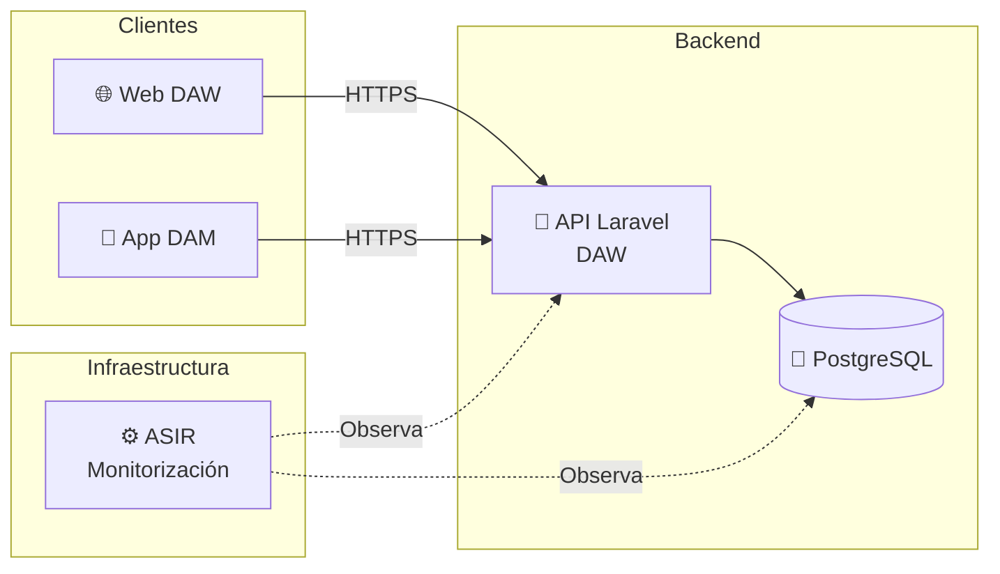
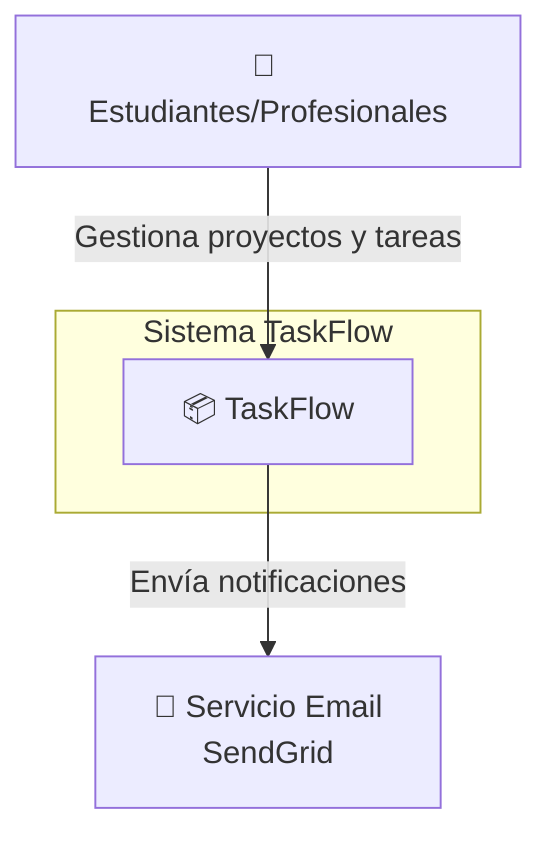
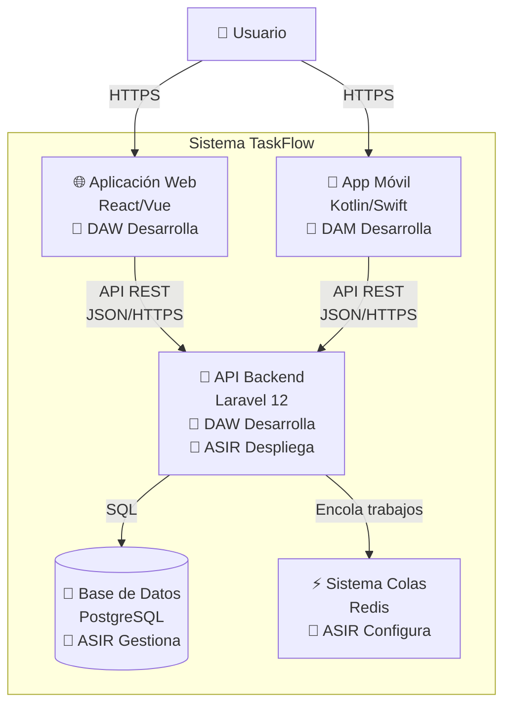
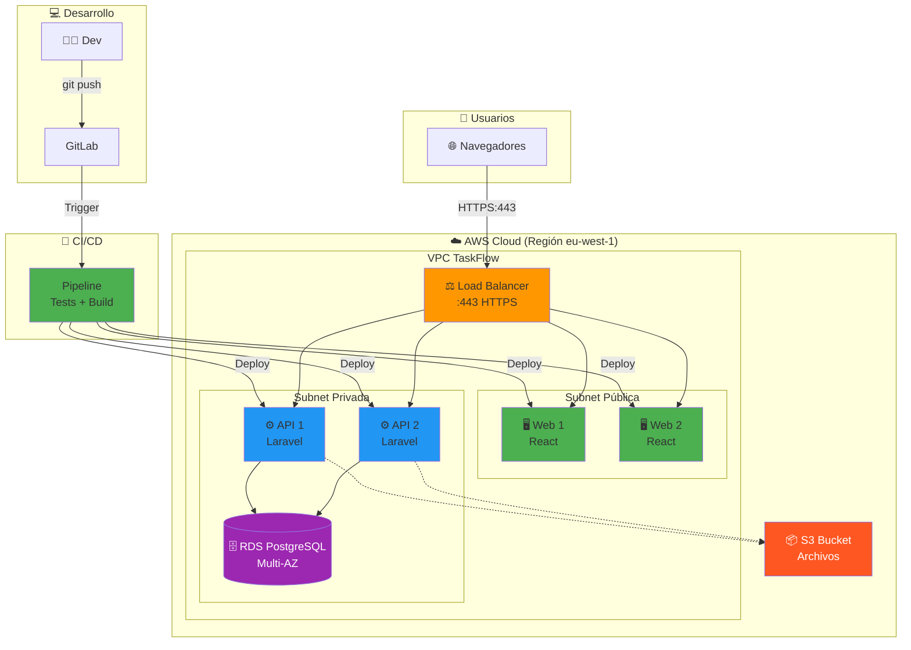
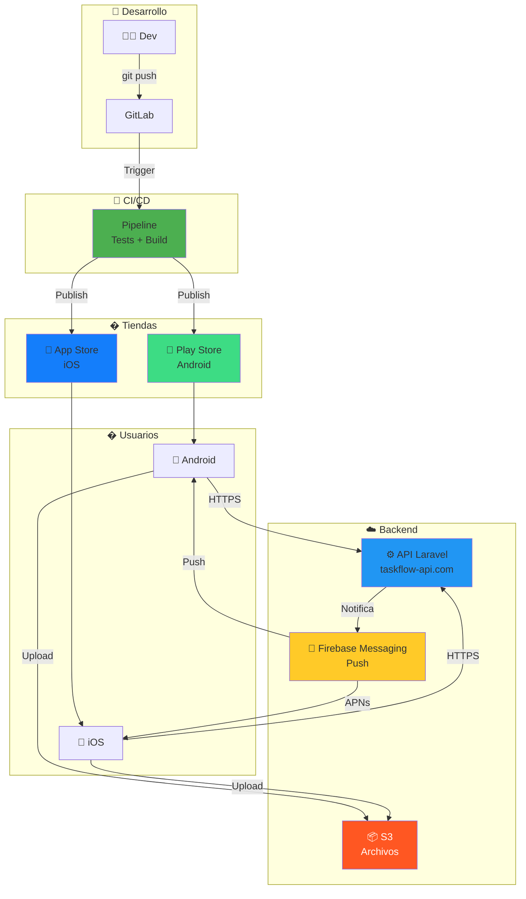
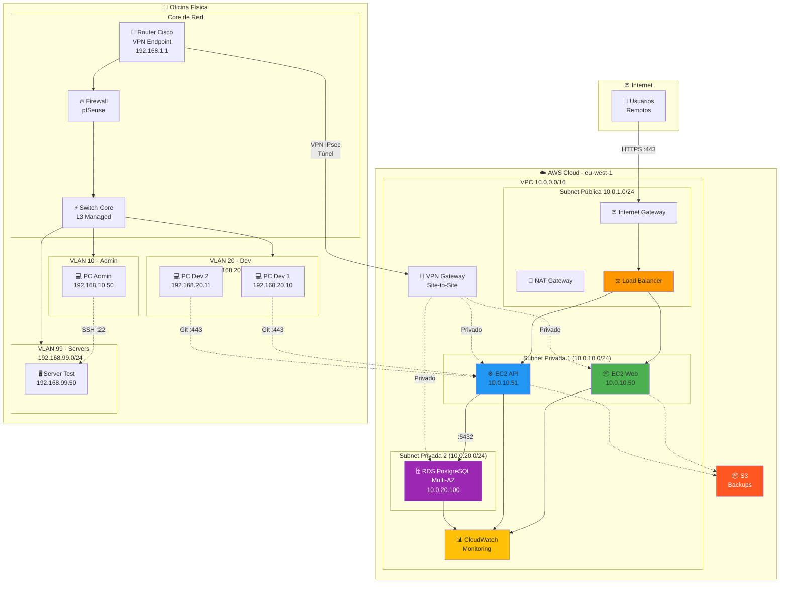
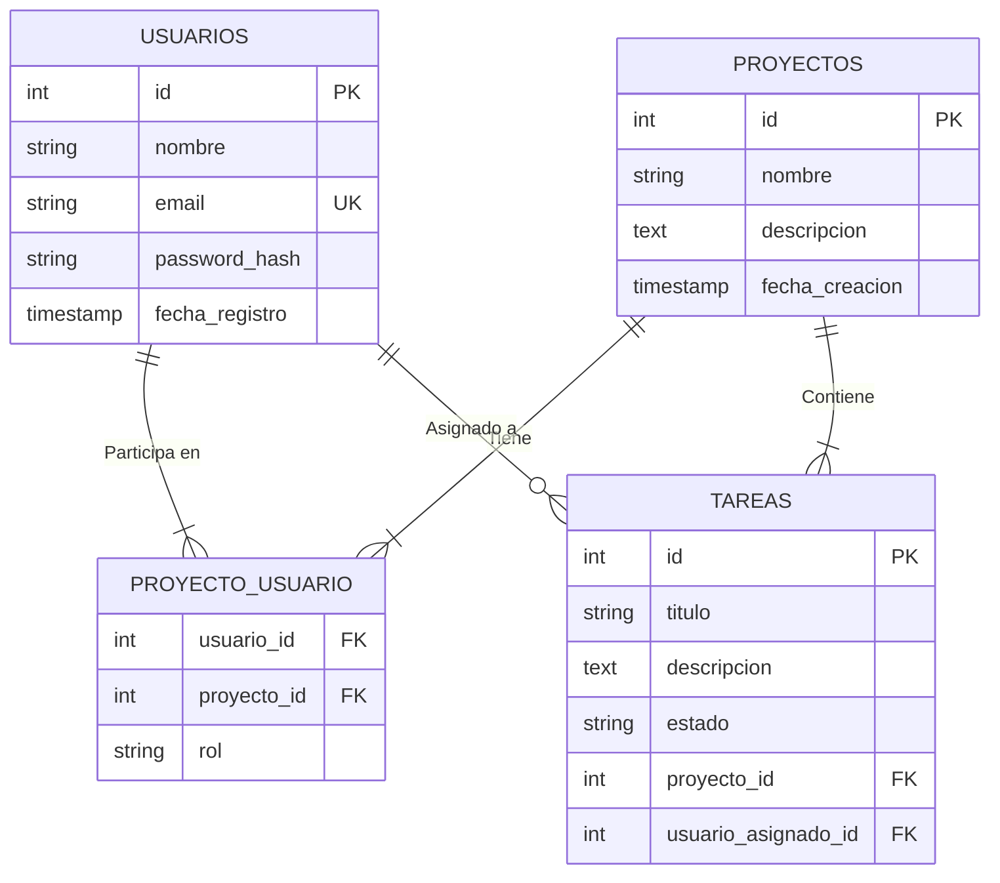
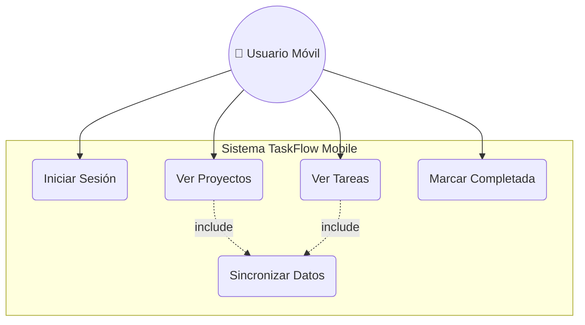
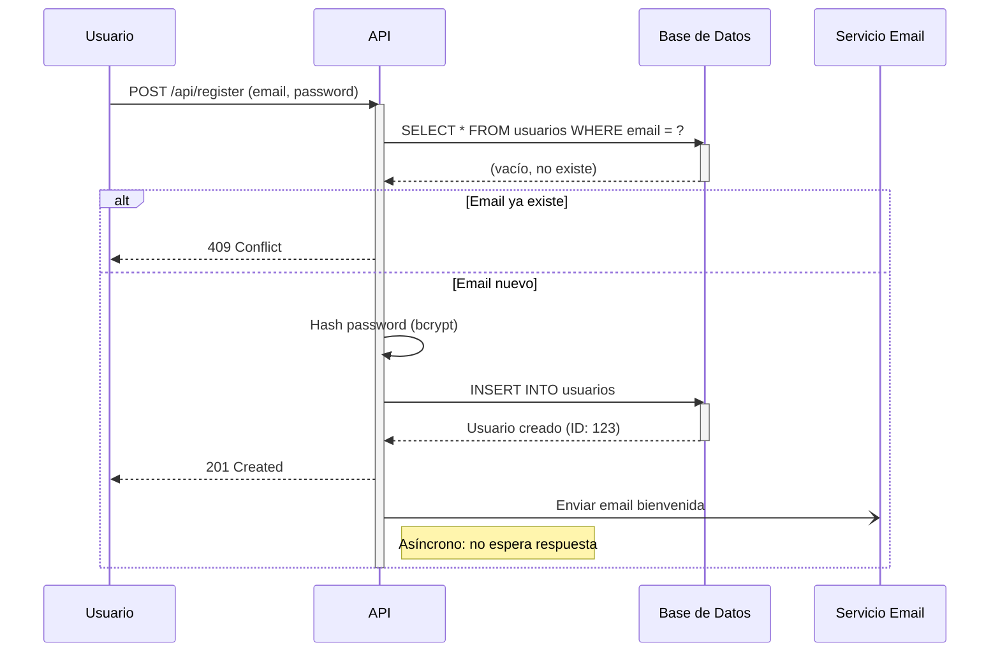

<SlidesViewer>

# Diseño de Arquitectura y Diagramas Técnicos

## Proyecto Intermodular II | El Plano Maestro del Proyecto

-----

## ¿Qué vamos a aprender hoy?

El arte de diseñar y comunicar la arquitectura de software mediante diagramas técnicos, desde la visión de alto nivel hasta los detalles de implementación.

**Ejemplo central: El ecosistema completo de TaskFlow (DAW, DAM, ASIR).**

1. **¿Qué es la Arquitectura de Software?**: Monolitos vs Microservicios, API-First.
2. **Diagramas de Alto Nivel (C4 Model)**: Contexto, Contenedores, Despliegue.
3. **Diagramas Entidad-Relación (ERD)**: Modelado de bases de datos.
4. **Diagramas de Casos de Uso**: Definiendo funcionalidades desde la vista del usuario.
5. **Diagramas de Secuencia**: Flujos técnicos de interacción entre componentes.
6. **Herramientas Visuales**: Draw.io, Lucidchart, dbdiagram.io.
7. **Diagramas como Código**: Mermaid y la filosofía DaC (Diagrams as Code).
8. **Práctica: Diseñando TaskFlow**: Actividades específicas por equipo (DAW, DAM, ASIR).

-----

# **Capítulo 1: ¿Qué es la Arquitectura de Software?**

### Los cimientos invisibles del éxito

-----

## Definición

> **La arquitectura de software es el conjunto de decisiones estructurales fundamentales sobre cómo organizar un sistema: sus componentes, sus responsabilidades y cómo se comunican entre sí.**

Es el **plano maestro** que permite que equipos diferentes (DAW, DAM, ASIR) construyan piezas que encajan perfectamente.

-----

## Estilos arquitectónicos

### Monolito

**Características:**

- Todo el código en una sola aplicación
- Base de datos única compartida
- Despliegue como una unidad

**Ventajas:** Simplicidad inicial, desarrollo rápido
**Desventajas:** Difícil escalar, acoplamiento alto

### Microservicios

**Características:**

- Sistema dividido en servicios pequeños e independientes
- Cada servicio con su propia base de datos
- Comunicación mediante APIs

**Ventajas:** Escalabilidad, resiliencia, equipos autónomos
**Desventajas:** Complejidad operacional, latencia de red

-----

## Nuestro enfoque: API-First (Híbrido)

**TaskFlow** usa arquitectura **API-First**:

- Backend (DAW) expone API REST como "fuente de verdad"
- Frontend Web (DAW) consume la API
- App Móvil (DAM) consume la misma API
- Infraestructura (ASIR) soporta y monitoriza todo



-----

# **Capítulo 2: Diagramas de Alto Nivel**

### La vista de pájaro: Contexto, Contenedores, Despliegue

-----

## El Modelo C4

**C4 = Context, Containers, Components, Code**

Es un conjunto de abstracciones para visualizar arquitectura en diferentes niveles de zoom.

### Nivel 1: Diagrama de Contexto

**¿Qué muestra?** El sistema como caja negra y su entorno



**Perspectivas por equipo:**

:::tabs
==DAW
Tu enfoque: La API es el corazón que expone endpoints REST a todos los clientes.

==DAM
Tu enfoque: La app móvil es un cliente más que consume la API, con capacidad offline.

==ASIR
Tu enfoque: El sistema completo debe ser observable, escalable y resiliente.
:::

-----

## Nivel 2: Diagrama de Contenedores

**¿Qué muestra?** Los bloques técnicos principales del sistema



-----

## Diagrama de Despliegue

**¿Qué muestra?** Dónde vive cada componente (servidores, cloud, redes)

**Responsabilidad principal: ASIR**

**Diferencias entre equipos:**

:::tabs
==DAW

Backend Laravel en EC2 + Frontend en S3 + RDS PostgreSQL con CI/CD



==DAM

Apps móviles distribuidas vía tiendas + Firebase + Backend con CI/CD



==ASIR

Infraestructura completa: Cloud AWS + Red física con VPN Site-to-Site



:::

-----

# **Capítulo 3: Diagramas Entidad-Relación (ERD)**

### El plano de la base de datos

-----

## ¿Qué es un ERD?

> Un ERD es el plano detallado de la estructura de la base de datos: tablas, columnas, tipos de datos y relaciones entre ellas.

**Propósito:** Diseñar cómo se almacenan y relacionan los datos antes de escribir una sola línea de SQL.

**Responsabilidad principal: DAW** (pero DAM y ASIR deben entenderlo)

-----

## Componentes clave

### Entidades (Tablas)

Representan conceptos del negocio: `USUARIOS`, `PROYECTOS`, `TAREAS`

### Atributos (Columnas)

Propiedades de cada entidad: `id`, `nombre`, `email`, `password_hash`

### Relaciones y Cardinalidad

- **1:1** (Uno a Uno): Un usuario tiene un perfil
- **1:N** (Uno a Muchos): Un proyecto tiene muchas tareas
- **N:M** (Muchos a Muchos): Usuarios ↔ Proyectos (requiere tabla pivote)

-----

## ERD de TaskFlow (Básico)



-----

# **Capítulo 4: Diagramas de Casos de Uso**

### Definiendo QUÉ hace el sistema

-----

## ¿Qué es un Caso de Uso?

> Un caso de uso describe una funcionalidad del sistema desde la perspectiva de un actor (usuario o sistema externo).

**Propósito:** Documentar los requisitos funcionales de forma visual y comprensible.

**Responsabilidad principal: DAM** (funcionalidades móviles) y **DAW** (funcionalidades web)

-----

## Componentes

### Actores

Usuarios o sistemas externos: `Usuario Registrado`, `Administrador`, `Sistema de Email`

### Casos de Uso

Acciones que el actor puede realizar: `Iniciar Sesión`, `Crear Tarea`, `Ver Proyectos`

### Relaciones

- **`<<include>>`**: Obligatorio (Ej: Todas las acciones incluyen "Validar Autenticación")
- **`<<extend>>`**: Opcional (Ej: Crear tarea puede extenderse con "Adjuntar Archivo")
- **Herencia**: Un `Administrador` hereda las funcionalidades de `Usuario Registrado`

-----

## Diagrama de Casos de Uso - TaskFlow Mobile (Básico)



-----

# **Capítulo 5: Diagramas de Secuencia**

### Mostrando CÓMO interactúan los componentes

-----

## ¿Qué es un Diagrama de Secuencia?

> Un diagrama de secuencia muestra la interacción entre componentes a lo largo del tiempo, en un flujo específico.

**Propósito:** Documentar el comportamiento técnico detallado de un caso de uso.

**Responsabilidad:** Todos los equipos (cada uno diseña sus flujos)

-----

## Componentes

### Participantes (Líneas de Vida)

Componentes que interactúan: `Cliente`, `API`, `Base de Datos`, `Servicio Email`

### Mensajes

- **Síncronos** (`->>`) flecha sólida: El emisor espera respuesta
- **Asíncronos** (`-)`) flecha discontinua: El emisor NO espera respuesta

### Fragmentos

- **`alt`** (alternativa): if-else
- **`loop`**: bucles (para cada elemento...)
- **`opt`**: opcional (solo si se cumple condición)
- **`par`**: paralelo (operaciones simultáneas)

-----

## Diagrama de Secuencia - Registro de Usuario



**Nota:** En el Capítulo 8, diseñarás flujos más complejos (añadir comentario con notificación, sincronización con conflictos).

-----

# **Capítulo 6: Herramientas Visuales**

### WYSIWYG: What You See Is What You Get

-----

## Draw.io (diagrams.net)

**Propósito:** Diagramas de todo tipo con control visual total

**Ventajas:**

- Gratuita y open source
- Integración con VS Code, Google Drive, GitHub
- Bibliotecas de iconos (AWS, Azure, UML, Redes)

**Casos de uso:**

- Diagramas de despliegue (ASIR)
- Diagramas de red física (ASIR)
- Prototipos rápidos de arquitectura

-----

## Lucidchart

**Propósito:** Colaboración en tiempo real

**Ventajas:**

- Interfaz profesional
- Comentarios y revisiones
- Templates predefinidos

**Desventajas:**

- Plan gratuito muy limitado (3 diagramas)

-----

# **Capítulo 7: Diagramas como Código (Mermaid)**

### La revolución: Versionar los diagramas con Git

-----

## ¿Qué es "Diagrams as Code" (DaC)?

> En lugar de "dibujar" un diagrama con el ratón, lo describes escribiendo texto. La herramienta genera el diagrama automáticamente.

**Ventaja clave:** El diagrama vive en un archivo `.md` que se versiona en Git junto al código.

-----

## ¿Por qué Mermaid?

**Mermaid** es el estándar moderno de diagramas como código.

**Beneficios:**

1. **Se versiona con Git**: El diagrama cambia cuando el código cambia (mismo commit)
2. **Fuente única de verdad**: No hay archivos `.png` perdidos en Google Drive
3. **Renderizado nativo**: GitHub, GitLab, VS Code, Notion lo muestran automáticamente
4. **Eficiencia**: Más rápido que arrastrar cajas manualmente

-----

## Sintaxis básica de Mermaid

### Flowcharts (Diagramas de Flujo)

```markdown
flowchart TD
    A[Inicio] --> B{¿Usuario autenticado?}
    B -->|Sí| C[Mostrar dashboard]
    B -->|No| D[Redirigir a login]
```

### ERD (Entidad-Relación)

```markdown
erDiagram
    USUARIOS ||--|{ TAREAS : "tiene asignadas"
    USUARIOS {
        int id PK
        string email UK
    }
```

### Sequence Diagrams (Diagramas de Secuencia)

```markdown
sequenceDiagram
    Cliente->>API: POST /login
    API->>BD: SELECT * FROM usuarios
    BD-->>API: Datos usuario
    API-->>Cliente: 200 OK (Token)
```

-----

# **Capítulo 8: Práctica - Diseñando TaskFlow**

### De la teoría a la práctica: Ahora sois los arquitectos

-----

## Objetivo general

Cada equipo debe crear **2 diagramas específicos** que realmente necesitaréis durante el desarrollo de TaskFlow.

**Criterio de éxito:** Los diagramas deben responder preguntas reales del proyecto y servir como contratos entre equipos.

-----

## Tareas por equipo

:::tabs
==📘 Equipo DAW

### Tarea 1: Ampliar el ERD (Capítulo 3)

**Partir de:** ERD básico de 4 entidades visto en teoría

**Ampliar con:**

- `COMENTARIOS` (1:N con TAREAS)
- `ETIQUETAS` (N:M con TAREAS)
- `ARCHIVOS_ADJUNTOS` (1:N con TAREAS)
- Modificar TAREAS: añadir `fecha_limite`, `prioridad`, `usuario_creador_id`

**Entregable:** ERD completo de 7 entidades + consultas SQL de ejemplo

### Tarea 2: Diagrama de Secuencia - Añadir Comentario con Notificación

**Diseñar flujo:**

1. Usuario añade comentario a tarea
2. Sistema valida autenticación y permisos
3. Sistema inserta comentario en BD
4. Sistema envía notificación al usuario asignado (asíncrono)
5. Websocket actualiza UI en tiempo real

**Entregable:** Diagrama con `alt`, `activate`, mensajes síncronos/asíncronos + controlador Laravel

==📗 Equipo DAM

### Tarea 1: Ampliar Casos de Uso (Capítulo 4)

**Partir de:** Diagrama básico con funcionalidades esenciales

**Ampliar con:**

- Gestionar Comentarios (añadir, ver, editar)
- Adjuntar Archivos (solo Usuario Premium)
- Recibir Notificaciones Push
- Filtrar Tareas por Etiqueta
- Configurar Preferencias Offline

**Entregable:** 12+ casos de uso, 3 actores (Usuario, Usuario Premium, Sistema Notificaciones), relaciones `<<include>>`, `<<extend>>`, herencia

### Tarea 2: Sincronización con Resolución de Conflictos (Capítulo 5)

**Escenario complejo:**

- Usuario A modifica tarea offline → sincroniza primero (versión 2)
- Usuario B modifica misma tarea offline → intenta sincronizar (409 Conflict)
- Sistema muestra diálogo de resolución de conflicto

**Entregable:** Diagrama con `par`, `alt`, `opt` + código Kotlin de versioning

==📕 Equipo ASIR

### Tarea 1: Despliegue Multi-Entorno (Capítulo 2B)

**Diseñar 3 entornos:**

- **Desarrollo:** Minimalista (~30€/mes)
- **Staging:** Intermedio (~60€/mes)
- **Producción:** Completo con HA, Auto Scaling, Redis (~180€/mes)

**Incluir:**

- Pipeline CI/CD (GitHub Actions → DEV → STAGING → PROD)
- 3 VPCs separadas con subnets públicas/privadas
- Security Groups específicos por entorno

**Entregable:** Diagrama multi-entorno + justificación de costos + IaC (Terraform/CloudFormation)

### Tarea 2: Red Híbrida Cloud + Oficina (Capítulo 2B)

**Diseñar:**

- **Cloud AWS:** VPC 10.0.0.0/16 con subnets
- **Oficina Física:** 4 VLANs (Admin, Dev, Testing, Servers)
- **VPN Site-to-Site IPsec:** Router Cisco ↔ AWS VPN Gateway

**Incluir:**

- Tabla completa de reglas de firewall por VLAN
- Security Groups AWS para acceso desde VPN
- Plan de routing estático

**Entregable:** Diagrama híbrido + firewall rules + DRP (Disaster Recovery Plan)
:::

</SlidesViewer>
